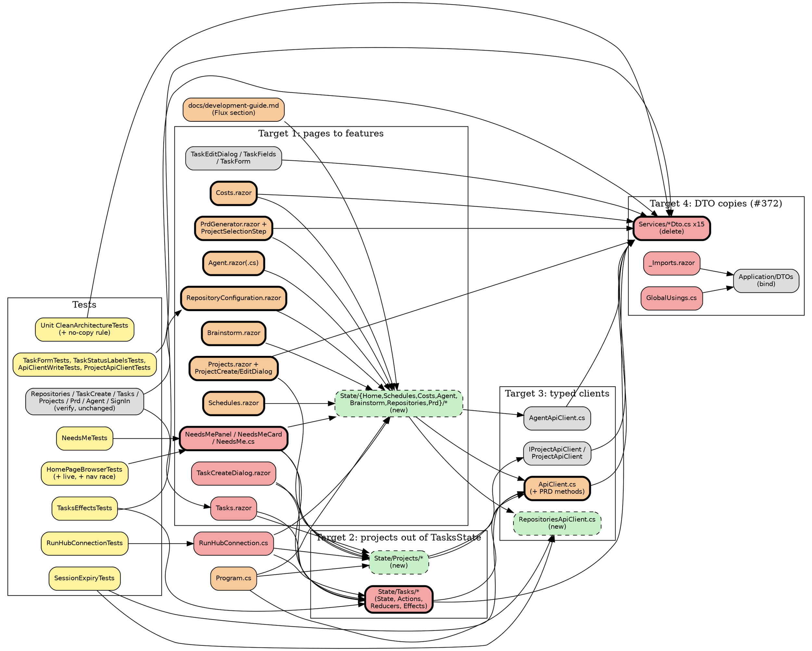

# Impact Analysis: Phase 2.14, Flux across the Web app

Input: `docs/superpowers/specs/2026-10-16-phase-2.14-flux-across-the-web-app-design.md` (approved; the owner confirmed
#372 and the live Home on 2026-10-16). Branch `phase/2.14-flux`. Analysis only: no code was changed.

## Summary

| Metric | Value |
|---|---|
| Date | 2026-10-16 07:53 |
| Refactor Type | Architectural (target 1), Move (target 2), Change Interface (target 3), Delete and rebind (target 4) |
| Targets | 4 |
| Directly Affected Files | 54 existing files |
| Transitively Affected Files | 17 existing files |
| Total Affected Files | 71 existing files, plus about 51 new files (8 features of 4 files, 1 client, about 18 test files) |
| Breaking Changes | 25 files: 15 deletions and 10 that stop compiling |
| Risks Identified | 17 |
| Risk Level | High: more than 50 files and 4 high-severity risks |

Classification of the 71 existing files: **25 Breaking, 16 Update Required, 10 Test Impact, 20 Cosmetic or verify-only.**

Targets, as the owner confirmed them:

1. **Page state into Flux features (Architectural).** Home, Projects, Schedules, Costs, Agent, Brainstorm, Git
   Repositories and the PRD Generator move to `HomeState`, `ProjectsState`, `SchedulesState`, `CostsState`,
   `AgentState`, `BrainstormState`, `RepositoriesState` and `PrdState`. The pattern is `State/Tasks` and `State/Runs`.
2. **Projects out of `TasksState` (Move).** `Projects`, `ProjectNames`, `ProjectsError`, `ProjectsRequested`, the three
   `TaskProjects*` actions, their reducers and `TasksEffects.LoadProjectsAsync` move to a shared `ProjectsState`.
3. **Typed clients only (Change Interface).** No component injects `HttpClient`. Three do today:
   `RepositoryConfiguration.razor`, `PrdGenerator.razor` and `PrdGeneratorSteps/ProjectSelectionStep.razor`.
4. **Delete the 15 Web DTO copies (#372)** and bind the `Daedalus.Application.DTOs` types.

Findings that change the plan:

- **No DTO copy differs on purpose.** Every difference is drift or a defensive nullability. Two kinds matter:
  `ProjectDto` gains a positional `DefaultBranch`, which breaks test code that constructs it, and the three cost DTOs
  gain fields the page never shows. None needs a view model. See "DTO differences".
- **Git Repositories cannot reuse `ApiClient`'s failure text.** The browser suite asserts "The server answered
  {status}" on refused writes and "500" on a failed read. `ApiClient.ReadFailureReasonAsync` would return the
  ProblemDetails `detail` instead. The repositories client must keep the page's own wording. See R2.
- **The edit dialog must keep its single-project read.** `TaskCreateBrowserTests.A_failed_project_read_says_why_in_the_edit_dialog`
  refuses only `**/api/projects/*`. If `TaskEditDialog` read the shared list instead, the test would fail. See R4.
- **The spec's "period filter" on Costs does not exist.** Costs has no period filter. Its state is the summary, the
  per-project costs, the pricing list, the estimator inputs and the per-project task-cost cache. See R14.
- **Costs, Schedules and Brainstorm have no browser scenarios of their own.** Only the navigation, shell, contrast and
  sign-in sweeps cover them. The spec's mitigation, "the browser suite pins every behaviour", does not hold for them.
  See R7.
- **`PrdGenerator` reads API responses case-sensitively.** It calls `JsonSerializer.Deserialize<T>(json)` with no Web
  options, against camelCase responses. By reading the code, the generated PRD binds nulls, and `PrdReviewStep` then
  dereferences `Prd.Goals`. No test covers generate or convert. The typed client fixes this, but that changes
  behaviour. See R8.

## Dependency Graph

Arrows point from a dependent to what it depends on. Red is Breaking, orange is Update Required, yellow is Test Impact
and gray is Cosmetic or verify-only. A bold border marks a target. New files are green and dashed.

Discovery depth. Depth 1 holds the targets and every file that names a target symbol. Depth 2 holds the following:

- `RunHubConnection` and `RunHubConnectionTests`, through the `TasksEffects` and new-effects constructor change.
- `Program.cs`, because every new effect and the new client are registered there.
- `SessionExpiryTests`, because every new client call must join `Calls()`.
- `NeedsMeTests`, through the `NeedsMe` change.
- The browser scenarios and `E2EServerFixture`, which only drive the pages.
- The docs.

The closure ends at depth 2. Nothing outside `Daedalus.Web`, `Daedalus.Tests.Unit` and
`Daedalus.Tests.Playwright.Browser` is reached:

- `Daedalus.Tests.Playwright.Api` does not reference `Daedalus.Web`.
- The Integration `CleanArchitectureTests` names only the Application `CreateTaskDto`.
- No API endpoint changes.

## Affected Files

Paths are under `src/Daedalus.Web/` unless they start with `tests/` or `docs/`. T1 to T4 are the targets above.

| # | File | Classification | Change Required | Caused By | Complexity |
|---|---|---|---|---|---|
| 1 | Services/CostDayDto.cs | Breaking | Delete; bind `Application.DTOs.CostDayDto` | T4 | Trivial |
| 2 | Services/CostEstimateDto.cs | Breaking | Delete | T4 | Trivial |
| 3 | Services/CostSliceDto.cs | Breaking | Delete | T4 | Trivial |
| 4 | Services/CostSummaryDto.cs | Breaking | Delete; the App type adds `Excluded` | T4 | Trivial |
| 5 | Services/CreateProjectDto.cs | Breaking | Delete; the App type adds optional `RepositoryUrl`, `DefaultBranch` | T4 | Trivial |
| 6 | Services/CreateTaskDto.cs | Breaking | Delete; move the Web summary's "null prompt uses the description" note to the App doc | T4 | Trivial |
| 7 | Services/ModelPricingDto.cs | Breaking | Delete | T4 | Trivial |
| 8 | Services/PagedResultDto.cs | Breaking | Delete | T4 | Trivial |
| 9 | Services/ProjectCostDto.cs | Breaking | Delete; the App type adds `Excluded`, `Scope` | T4 | Trivial |
| 10 | Services/ProjectDto.cs | Breaking | Delete; the App type has `string RepositoryUrl` and adds `DefaultBranch` | T4 | Trivial |
| 11 | Services/TaskCostDto.cs | Breaking | Delete; the App type adds `Excluded`, `Scope` | T4 | Trivial |
| 12 | Services/TaskDto.cs | Breaking | Delete; move the Web summary's `RunStatusLabels` note to `TaskStatusLabels` if it is wanted | T4 | Trivial |
| 13 | Services/TaskExecutionDto.cs | Breaking | Delete | T4 | Trivial |
| 14 | Services/UpdateProjectDto.cs | Breaking | Delete | T4 | Trivial |
| 15 | Services/UpdateTaskDto.cs | Breaking | Delete | T4 | Trivial |
| 16 | GlobalUsings.cs | Breaking | Add `global using Daedalus.Application.DTOs;`. Without it, every `.cs` user of the 15 names stops compiling | T4 | Trivial |
| 17 | _Imports.razor | Breaking | Add `@using Daedalus.Application.DTOs`, and `@using Daedalus.Web.State.<Feature>` per new feature | T4, T1 | Trivial |
| 18 | State/Tasks/TasksState.cs | Breaking | Drop `Projects`, `ProjectNames`, `ProjectsError`, `ProjectsRequested` and the long lifetime remark; shrink `Initial` | T2 | Moderate |
| 19 | State/Tasks/TasksActions.cs | Breaking | Move `TaskProjectsLoadStarted`, `TaskProjectsLoaded` and `TaskProjectsLoadFailed` to `State/Projects` under new names | T2 | Trivial |
| 20 | State/Tasks/TasksReducers.cs | Breaking | Drop the three project reducers and the project fields reset in `TasksClosed` | T2 | Trivial |
| 21 | State/Tasks/TasksEffects.cs | Breaking | Drop `LoadProjectsAsync` and `ProjectPage`; `RefreshAsync` reloads only the board | T2 | Trivial |
| 22 | State/RunHubConnection.cs | Breaking | Inject `ProjectsEffects` and `HomeEffects`. `OnChangedAsync` also calls `HomeEffects.OnRunChangedAsync`, and `RefreshAsync` also calls `ProjectsEffects.RefreshAsync` and `HomeEffects.RefreshAsync` | T2, T1 (live Home) | Moderate |
| 23 | Pages/Tasks.razor | Breaking | Read `ProjectNames` and `ProjectsError` from `IStore<ProjectsState>`, subscribe it, and call `ProjectsEffects.LoadAsync` for init and Retry. Its `SessionExpiry.IsSigningIn` checks drop once the effects swallow `SigningInAgain` | T2 | Moderate |
| 24 | Components/TaskCreateDialog.razor | Breaking | Read `Projects` and `ProjectsError` from `IStore<ProjectsState>`; the preselect logic is unchanged | T2 | Trivial |
| 25 | Components/NeedsMePanel.razor | Breaking | Becomes a `FluxComponent` over `HomeState`. The 4-card `Card` class and `LoadAsync` move to `HomeEffects`; New task calls `ProjectsEffects.LoadAsync`. The role gate moves into the effect; the page still decides `_canView` for rendering. Dispatches `HomeClosed` on dispose | T1, T2 | Complex |
| 26 | Program.cs | Update Required | Register `ProjectsEffects`, `HomeEffects`, `SchedulesEffects`, `CostsEffects`, `AgentEffects`, `BrainstormEffects`, `RepositoriesEffects`, `PrdEffects` and `RepositoriesApiClient`, all scoped. Keep the scoped `HttpClient`: the typed clients still use it | T1, T3 | Trivial |
| 27 | Services/ApiClient.cs | Update Required | Add `GeneratePrdAsync` and `ConvertPrdToTasksAsync`. Drop the stale "DTOs (copied from API for client-side use)" comment | T3, T4 | Trivial |
| 28 | Components/NeedsMeCard.razor | Update Required | Parameters stay. `NeedsMe.ShownError` becomes redundant once `HomeEffects` never stores `SigningInAgain`; keep the filter or drop it in the same step | T1 | Trivial |
| 29 | Services/NeedsMe.cs | Update Required | The queries, `RecentPullRequests` and the empty texts stay as pure helpers that `HomeEffects` and the panel use. `ShownError` goes with the effect rule | T1 | Trivial |
| 30 | Pages/Projects.razor | Update Required | `FluxComponent` over `ProjectsState`: list, loading, error and selected project with tasks. Effects own `GetAllProjectsAsync`, `GetProjectWithTasksAsync` and `DeleteProjectAsync`; toasts stay in the page from a `Last*` outcome. *Superseded by ruling 8 in `docs/plans/2026-10-16-phase-2.14-rulings.md`: writes return their outcome to the component that asked; there is no last-outcome state.* | T1 | Moderate |
| 31 | Components/ProjectCreateDialog.razor | Update Required | Submit through `ProjectsEffects.CreateAsync` and reload the shared list; the toast stays in the dialog | T1 | Trivial |
| 32 | Components/ProjectEditDialog.razor | Update Required | Submit through `ProjectsEffects.UpdateAsync` | T1 | Trivial |
| 33 | Pages/Schedules.razor | Update Required | `SchedulesState` holds the overview with its Loading, Loaded or Error state, the history by schedule id, the selected run and the resend state by execution id, all immutable. The deep link (`scheduleId` query), JS focus and the mobile expand stay in the page | T1 | Complex |
| 34 | Pages/Costs.razor | Update Required | `CostsState` holds the summary, per-project costs, pricing, the estimator inputs and estimate, and the task-cost cache by project. The two `async void` handlers become dispatches. There is no period filter (R14) | T1 | Moderate |
| 35 | Pages/Agent.razor | Update Required | `AgentState` holds agents, sessions, detail, transcript, streaming, error, memories and recall. `SendAsync` and `Apply` become an effect that dispatches one action per SSE event. Escape and JS interop stay in the page. Keep the 50 ms render throttle (R5) | T1 | Complex |
| 36 | Pages/Agent.razor.cs | Update Required | `ChatMessage` and `ToolCallView` are mutable today, with a `StringBuilder` and `Finish()`. They become immutable records in `State/Agent`; `ErrorView` moves with them. `DisposeInteropAsync` stays | T1 | Complex |
| 37 | Pages/Brainstorm.razor | Update Required | `BrainstormState` holds the session, and the sending, advancing and generating flags. Effects own the 5 `ApiClient` brainstorm calls; Generate tasks still navigates in the page | T1 | Moderate |
| 38 | Pages/RepositoryConfiguration.razor | Update Required | `@inject HttpClient` goes, and the page reads `RepositoriesState`: list, Forbidden, LoadError, Loading, and the last write outcome. The refusal and failure copy must not change (R2). *Superseded by ruling 8 in `docs/plans/2026-10-16-phase-2.14-rulings.md`: writes return their outcome to the component that asked; there is no last-outcome state.* | T1, T3 | Moderate |
| 39 | Components/PrdGenerator.razor | Update Required | `@inject HttpClient` goes. `PrdState` holds the step, project, generated PRD, created tasks, generating and converting, and the error. The redundant `TaskDto` alias goes | T1, T3, T4 | Moderate |
| 40 | Components/PrdGeneratorSteps/ProjectSelectionStep.razor | Update Required | `@inject HttpClient` goes. The list comes from `ProjectsState` (recommended) or `PrdState`. A failure still renders as "No projects found" with no error UI, so nothing visible changes. The `ProjectDto` alias goes | T3, T2 | Trivial |
| 41 | docs/development-guide.md | Update Required | "Web state with ZeroAlloc.Flux" says "phase 2.14 moves the remaining pages". Rewrite it: every page; session expiry in effects; outcome as state with toasts in components (*Superseded by ruling 8 in `docs/plans/2026-10-16-phase-2.14-rulings.md`: writes return their outcome to the component that asked; there is no last-outcome state.*); the `ProjectsState` lifetime rule; Home on the hub; no Web DTO copies | T1, T2, T4 | Moderate |
| 42 | tests/Daedalus.Tests.Unit/Web/TasksEffectsTests.cs | Test Impact | Move the 5 project tests to `ProjectsEffectsTests`. Fix `Project()` and line 229 to the 9-argument `ProjectDto`, with `RepositoryUrl` `""` and `DefaultBranch` `"main"`. Add `using Daedalus.Application.DTOs;` | T2, T4 | Moderate |
| 43 | tests/Daedalus.Tests.Unit/Web/TaskFormTests.cs | Test Impact | Add `using Daedalus.Application.DTOs;`; the shapes are unchanged | T4 | Trivial |
| 44 | tests/Daedalus.Tests.Unit/Web/TaskStatusLabelsTests.cs | Test Impact | Add `using Daedalus.Application.DTOs;` | T4 | Trivial |
| 45 | tests/Daedalus.Tests.Unit/Web/ApiClientWriteTests.cs | Test Impact | Add `using Daedalus.Application.DTOs;`. Add PRD write tests, or put them in a new `ApiClientPrdTests` | T4, T3 | Trivial |
| 46 | tests/Daedalus.Tests.Unit/Web/ProjectApiClientTests.cs | Test Impact | Add `using Daedalus.Application.DTOs;` | T4 | Trivial |
| 47 | tests/Daedalus.Tests.Unit/Web/SessionExpiryTests.cs | Test Impact | Add `using Daedalus.Application.DTOs;`. Add every new client call to `Calls()`: the 5 repository calls and the 2 PRD calls, with their `CallAsync` cases. The class claims "Every client call that reaches the API" | T3, T4 | Moderate |
| 48 | tests/Daedalus.Tests.Unit/Web/RunHubConnectionTests.cs | Test Impact | `Hub(...)` builds the new constructor with `ProjectsEffects` and `HomeEffects`. Add tests that a change re-fetches the Home cards and that a reconnect refreshes projects and Home | T2, T1 | Moderate |
| 49 | tests/Daedalus.Tests.Unit/Web/NeedsMeTests.cs | Test Impact | Drop the `ShownError` cases if it goes. The query and text cases stay | T1 | Trivial |
| 50 | tests/Daedalus.Tests.Unit/Architecture/CleanArchitectureTests.cs | Test Impact | New rule from the spec: no type in `WebAssembly` has the name of a type in `Daedalus.Application.DTOs`. Add a known-positive guard so the rule cannot pass vacuously. Red: restore one copy | T4 | Moderate |
| 51 | tests/Daedalus.Tests.Playwright.Browser/Scenarios/HomePageBrowserTests.cs | Test Impact | Add 2 tests. In "Home updates live on RunChanged", a started run appears in Running without a reload, using the `Runs.StartAsync` pattern of `RunsConsoleBrowserTests.RunDetail_LiveUpdate_AddsTheStepWithoutReload`. The navigation race test goes Home, New task, Tasks, then Home, and the picker and Project column hold projects. No existing assertion changes | T1, T2 | Moderate |
| 52 | Components/TaskEditDialog.razor | Cosmetic, verify | No edit. `ProjectDto` resolves to the App type. Keep `Api.GetProjectAsync`: the single-project read is what the browser test refuses (R4) | T4 | Trivial |
| 53 | Components/TaskFields.razor | Cosmetic, verify | No edit. The `(ProjectDto)item` casts resolve to the App type; the `RepositoryUrl` check is `IsNullOrWhiteSpace` and safe for both | T4 | Trivial |
| 54 | Services/TaskForm.cs | Cosmetic, verify | No edit; resolves to the App types, with identical shapes | T4 | Trivial |
| 55 | Services/TaskStatusLabels.cs | Cosmetic, verify | No edit; `TaskDto` is identical | T4 | Trivial |
| 56 | Services/IProjectApiClient.cs | Cosmetic, verify | No new method is needed; it resolves to the App types | T3, T4 | Trivial |
| 57 | Services/ProjectApiClient.cs | Cosmetic, verify | No edit needed. Its `HttpClient` use is a typed client's, which is allowed. Its refusal text "Failed to create project: {body}" stays as it is | T3, T4 | Trivial |
| 58 | Services/AgentApiClient.cs | Cosmetic, verify | No edit. It already imports `Daedalus.Application.DTOs`, but binds the Web `PagedResultDto` by enclosing-namespace precedence (R12) | T4 | Trivial |
| 59 | Components/RepositoryForm.razor | Cosmetic, verify | No edit. It mutates the `RepositoryConfigurationDto` copy the page hands it, so the page builds that copy from state, not the state's own instance | T1 | Trivial |
| 60 | Components/PrdGeneratorSteps/PrdReviewStep.razor | Cosmetic, verify | No edit; parameters only | T1 | Trivial |
| 61 | Components/PrdGeneratorSteps/RequirementsInputStep.razor | Cosmetic, verify | No edit; parameters only | T1 | Trivial |
| 62 | Components/PrdGeneratorSteps/TasksCreatedStep.razor | Cosmetic | Drop the now-redundant `TaskDto` alias | T4 | Trivial |
| 63 | tests/Daedalus.Tests.Playwright.Browser/Fixtures/E2EServerFixture.cs | Cosmetic, verify | No edit. It wires API-side DI only; Web DI runs in the browser from `Program.cs`. The broadcaster and hub are already registered (lines 257-264, 379), which the live Home test needs | T1 | Trivial |
| 64 | tests/Daedalus.Tests.Playwright.Browser/PageObjects/HomePage.cs | Cosmetic, verify | No edit expected. The live test uses `Row(Running, ...)` | T1 | Trivial |
| 65 | tests/Daedalus.Tests.Playwright.Browser/Scenarios/RepositoriesPageBrowserTests.cs | Cosmetic, verify | Unchanged. It is the guard for R2: it asserts "The server answered {status}", "could not be loaded" with "500", and the 403 warning | T1, T3 | Trivial |
| 66 | tests/Daedalus.Tests.Playwright.Browser/Scenarios/TaskCreateBrowserTests.cs | Cosmetic, verify | Unchanged. It guards R3 and R4: the projects routes `**/api/projects?*` and `**/api/projects/*` | T2 | Trivial |
| 67 | tests/Daedalus.Tests.Playwright.Browser/Scenarios/TasksPageBrowserTests.cs | Cosmetic, verify | Unchanged | T2 | Trivial |
| 68 | tests/Daedalus.Tests.Playwright.Browser/Scenarios/ProjectsPageBrowserTests.cs | Cosmetic, verify | Unchanged. It relies on the list's `Tasks` count, which `GET /api/projects` includes | T1 | Trivial |
| 69 | tests/Daedalus.Tests.Playwright.Browser/Scenarios/PrdGeneratorBrowserTests.cs | Cosmetic, verify | Unchanged; it covers only steps 1 and 2 | T1, T3 | Trivial |
| 70 | tests/Daedalus.Tests.Playwright.Browser/Scenarios/AgentPageBrowserTests.cs | Cosmetic, verify | Unchanged; it is the guard for R5 | T1 | Trivial |
| 71 | tests/Daedalus.Tests.Playwright.Browser/Scenarios/SignInBrowserTests.cs | Cosmetic, verify | Unchanged. It asserts that a signed-out visit to `/projects`, `/costs`, `/schedules`, `/repositories`, `/prd-generator` and `/agent` requests no `/api/`. Effects must still start only from an authorised page | T1 | Trivial |

**New files**, about 51:

- `State/{Home,Projects,Schedules,Costs,Agent,Brainstorm,Repositories,Prd}/` with `<F>State.cs`, `<F>Actions.cs`,
  `<F>Reducers.cs` and `<F>Effects.cs`. `State/Agent` adds the immutable transcript records.
- `Services/RepositoriesApiClient.cs`.
- In `tests/Daedalus.Tests.Unit/Web/`: `<F>ReducersTests.cs` and `<F>EffectsTests.cs` per feature, with a `Red:` line per
  assertion; `RepositoriesApiClientTests.cs`; and `ApiClientPrdTests.cs` (or extend `ApiClientWriteTests`).

**Not affected:**

- `tests/Daedalus.Tests.Playwright.Api`: no `Daedalus.Web` reference; it uses the Application DTOs.
- `tests/Daedalus.Tests.Integration/Architecture/CleanArchitectureTests.cs`: it names the Application `CreateTaskDto`.
- The Application DTOs themselves.
- Every controller.
- `Pages/Home.razor`, `Pages/Runs.razor`, `Pages/RunDetail.razor`, `Components/Runs/*` and `RunsMenuItem.razor`. The
  last starts the hub and keeps doing so.

### Target 3 detail: typed-client methods to add

Every endpoint already exists, so the API surface does not change.

| Caller today | New client method | Endpoint | Success | Failures the page shows today |
|---|---|---|---|---|
| RepositoryConfiguration `LoadRepositories` | `RepositoriesApiClient.GetAllAsync` | `GET /api/repositories` (Admin) | 200 `List<RepositoryConfigurationDto>` | 403 is Forbidden state, not a failure. Other status: "The server answered {HttpStatusText}.". Client timeout, as a `TaskCanceledException` not from the page: "The request timed out.". `HttpRequestException`, `JsonException` or `NotSupportedException`: the exception message. Session: `SigningInAgain`, shown as nothing |
| RepositoryConfiguration `ShowAddForm` | `RepositoriesApiClient.CreateAsync(CreateRepositoryConfigurationDto)` | `POST /api/repositories` | 201 with the created DTO, not read | "Failed to create repository. The server answered {status}." |
| RepositoryConfiguration `EditRepository` | `RepositoriesApiClient.UpdateAsync(Guid, UpdateRepositoryConfigurationDto)` | `PUT /api/repositories/{id}` | 204 | "Failed to update repository. The server answered {status}." |
| RepositoryConfiguration `ConfirmDelete` | `RepositoriesApiClient.DeleteAsync(Guid)` | `DELETE /api/repositories/{id}` | 204 | "Failed to delete repository. The server answered {status}." |
| RepositoryConfiguration `TestConnection` | `RepositoriesApiClient.TestConnectionAsync(Guid)` | `POST /api/repositories/{id}/test-connection` | 200 `TestConnectionResponse` | A non-2xx answer is a Warning, "Connection test failed."; an exception is an Error. `TestConnectionResponse` lives in `Daedalus.Api`, which Web cannot reference, so return a plain `Result` (R13) |
| PrdGenerator `HandleRequirementsSubmitted` | `ApiClient.GeneratePrdAsync(PrdRequestDto)` | `POST /api/prd/generate` (CodeAnalysis) | 200 `PrdResponseDto` | 400 `{ "error": ... }`; `ReadFailureReasonAsync` already reads `error` (R8) |
| PrdGenerator `HandleItemsSelected` | `ApiClient.ConvertPrdToTasksAsync(PrdConversionRequestDto)` | `POST /api/prd/convert-to-tasks` (TaskManagement) | 200 `List<TaskDto>` | 400 `{ "error": ... }` |
| ProjectSelectionStep `LoadProjects` | none: `ProjectsEffects.LoadAsync`, which uses `ApiClient.GetProjectsAsync` or `IProjectApiClient.GetAllProjectsAsync` | `GET /api/projects?page=1&pageSize=N` | 200 `PagedResultDto<ProjectDto>` | A failure renders as an empty list today; keep it so |

No method is added to `IProjectApiClient`. Projects, Schedules, Costs, Brainstorm, Agent and Home already have every
call they need: `ApiClient` has 5 cost, 3 schedule, 6 brainstorm and the run-list calls, and `AgentApiClient` has 8.

**Placement (my call, open to the owner):** a separate `RepositoriesApiClient`, as the spec says ("a typed repositories
client"). Its status-carrying failure text differs from `ApiClient.SendAsync`'s ProblemDetails text (R2), so putting
those methods on `ApiClient` would mix two failure contracts in one class.

## DTO differences

Method: each Web copy in `src/Daedalus.Web/Services/<Name>.cs` was diffed field by field against its Application type.
Most are in `src/Daedalus.Application/DTOs/<Name>.cs`; the cost types are all in `CostAnalyticsDtos.cs`.

Common to all 15:

- **No `[JsonPropertyName]`, `[JsonIgnore]` or converter on either side.** Both bind by C# name: the API writes MVC
  camelCase, and `ApiClient` reads with `JsonSerializerDefaults.Web`.
- **`RespectNullableAnnotations` is off in the Web reads.** A null in a non-nullable `string` does not throw.
- **No copy is constructed positionally in `src/`.** The `new XDto(...)` calls in Web are `CreateProjectDto`,
  `UpdateProjectDto`, `CreateTaskDto` and `UpdateTaskDto`, all of which match the App shape. `ProjectDto` and `TaskDto`
  are built in unit tests only.
- **The App types carry `[Validate]` and ZeroAlloc.Validation attributes on the request DTOs.** They also carry
  `internal` `IsPresent` and `*HasValue` helpers. None of these is serialised, and Web already binds `[Validate]`
  Application DTOs today (`CreateRepositoryConfigurationDto`), so nothing new reaches the WASM build.

| # | Copy | Same name, type and nullability | Differences: Web compared with App | Deliberate? | Action |
|---|---|---|---|---|---|
| 1 | `CostDayDto` | All 6 | None. App adds an XML summary | n/a | Delete |
| 2 | `CostEstimateDto` | All 7 | None | n/a | Delete |
| 3 | `CostSliceDto` | All 7 | None | n/a | Delete |
| 4 | `CostSummaryDto` | 11 of 11 Web fields | **App adds `ExcludedCostDto Excluded` at position 8**, between `UnreadableRecords` and `BySource`. The Web copy dropped the `excluded` JSON member; the App type binds it. Costs never shows it, so nothing visible changes | No: drift since `0560302e` and `80073ef6` | Delete. No view model |
| 5 | `CreateProjectDto` | All 3 Web fields | **App adds optional `string? RepositoryUrl = null, string? DefaultBranch = null`.** Web's 3-argument calls still compile. The POST body gains `"repositoryUrl":null,"defaultBranch":null`, which the API treats as absent. App adds `[Validate]`, `[Must]`, `[MaxLength]` and the CA1054/CA1056 suppressions | No | Delete |
| 6 | `CreateTaskDto` | All 11 | None in shape. App adds validation attributes and `IsPresent`. The Web summary documents that a null prompt falls back to the description, and so on; the App summary does not | No | Delete; move the summary text to the App type |
| 7 | `ModelPricingDto` | All 6 | None | n/a | Delete |
| 8 | `PagedResultDto<T>` | All 4 | None | n/a | Delete |
| 9 | `ProjectCostDto` | All 6 Web fields | **App adds `ExcludedCostDto Excluded, string Scope`** at positions 7 and 8. Costs does not show them for a project row | No: drift | Delete |
| 10 | `ProjectDto` | 7 of 8 Web fields | **(a) `RepositoryUrl` is `string?` in Web and `string` in App.** **(b) App adds `string DefaultBranch` at position 6, after `RepositoryUrl`**, so a positional construction needs 9 arguments, not 8. That breaks `TasksEffectsTests.Project()` and line 229. (c) Both carry CA1054 and CA1056 suppressions, with different justifications. The Web `string?` came with 2.13's picker in `48d192d5`, but the entity never holds null: `Project.RepositoryUrl` defaults to `""`, and `Create` maps null to `""`. `TaskFields` reads it with `IsNullOrWhiteSpace`, which is safe for both | Defensive, not a contract difference | Delete. The tests pass `""` and `"main"` |
| 11 | `TaskCostDto` | All 6 Web fields | **App adds `ExcludedCostDto Excluded, string Scope`** at positions 7 and 8 | No: drift | Delete |
| 12 | `TaskDto` | All 27, including `Uri? PullRequestUrl`, `string? RunStatus` and `string? AwaitingSignal` | None in shape. The summaries differ: Web cites `RunStatusLabels`, App cites the derivation from the run | n/a | Delete |
| 13 | `TaskExecutionDto` | All 13 | None | n/a | Delete |
| 14 | `UpdateProjectDto` | All 3 | None in shape. App adds validation | n/a | Delete |
| 15 | `UpdateTaskDto` | All 7 | None in shape. App adds validation and the `When` guards | n/a | Delete |

**Verdict:** no copy differs on purpose, so the spec's fallback, "keep a deliberate difference as a view model", is not
needed. There are two compile-time consequences:

- Tests that construct `ProjectDto` with 8 arguments.
- Files in namespace `Daedalus.Web.Services` that import `Daedalus.Application.DTOs` but bind the Web copy through
  enclosing-namespace precedence (R12).

**Not in #372's list:** `Services/StartWorkflowRunResponse.cs` copies `Daedalus.Api.Controllers.StartWorkflowRunResponse`,
an API type that Web cannot reference. It is out of scope. Either file it as a follow-up to move the record into
`Daedalus.Application.DTOs.WorkflowRuns` beside the hub contract, or drop it; decide at plan time.

## Risk Register

| # | Risk | Affected Files | Severity | Mitigation |
|---|---|---|---|---|
| R1 | **DTO rebind changes a binding or shape** (#372). `ProjectDto` gains positional `DefaultBranch`, and `RepositoryUrl` becomes non-nullable. The 3 cost DTOs gain `Excluded` and `Scope`. Files in `Daedalus.Web.Services` silently switch types | Services/*Dto.cs, GlobalUsings.cs, _Imports.razor, TasksEffectsTests, TaskFields.razor | High | Use the per-copy table above. Delete the 15 copies in one atomic group with the global using; build; run the unit suite, then the Tasks, TaskCreate, Projects and Home browser scenarios. Add the architecture rule that no Web type has the name of an Application DTO, so a copy cannot return |
| R2 | **Git Repositories' copy changes if it goes through `ApiClient`'s failure reader.** `ReadFailureReasonAsync` returns ProblemDetails `detail`, here "Refused by the test.". The page and the browser tests expect "The server answered {status}", "could not be loaded" with "500", a 403 Forbidden state and "The request timed out." | RepositoryConfiguration.razor, RepositoriesApiClient.cs, RepositoriesPageBrowserTests | High | The repositories client returns the status, not the server's detail. `GetAllAsync` returns a lookup like `RunLookup`, `Loaded(list)` or `Forbidden`, or a failure carrying `HttpStatusText.Of`. Writes fail with "The server answered {status}." and the page prefixes "Failed to … repository.". Unit-test each mapping, with a timeout distinct from page cancellation |
| R3 | **Shared `ProjectsState` brings back the lifetime race that `ProjectsRequested` fixed.** Blazor disposes the old page after it initialises the next, so a clear on close lands after the new page's load | State/Projects/*, Tasks.razor, NeedsMePanel.razor, TaskCreateDialog.razor, Projects.razor, ProjectSelectionStep.razor | High | Write the rule on `ProjectsState`. It is never cleared on page close, because it is shared and small. Every reader re-fetches when it opens: Tasks init, Home's New task, Projects init, the PRD step. A request sequence number drops an out-of-order response. A reconnect re-fetches only if a load was ever made. Add the Home, Tasks, Home browser test and reducer tests for the stale-response guard |
| R4 | **Moving the edit dialog onto the shared list breaks an unchanged browser test.** `A_failed_project_read_says_why_in_the_edit_dialog` refuses `**/api/projects/*`, the single-project GET, not the list | TaskEditDialog.razor, TaskCreateBrowserTests | Medium | Keep `TaskEditDialog`'s own `GetProjectAsync`. "The task dialogs read `ProjectsState`" applies to the create dialog only |
| R5 | **The Agent SSE stream in an effect drops, reorders or over-renders chunks.** Today `ChatMessage` is mutable, renders are throttled to 50 ms for `text-delta`, and Stop cancels a per-turn CTS. `StreamTurnAsync` throws `OperationCanceledException`, `HttpRequestException` and `AccessTokenNotAvailableException`. The session-switch guard `SameSession` keeps a late outcome off another session | Agent.razor, Agent.razor.cs, State/Agent/* | High | One action per event into immutable transcript records. The effect owns the turn CTS (`StopTurn`) and maps every exception to an action, as the page does now. Stamp each action with its session id and turn number so the reducer ignores stale ones. Keep the render throttle in the component: `ShouldRender` or a timer over the store, not in the reducer. Add a reducer test over a recorded stream; `AgentPageBrowserTests` (6) must stay green |
| R6 | **Home's live re-fetch storms or makes a test flaky.** Every committed run step sends `RunChanged`, and each change re-fetches 3 lists. "A card that cannot load says why…" relies on the error staying until Retry | HomeState/Effects, RunHubConnection.cs, HomePageBrowserTests | Medium | Re-fetch only Awaiting, Running and Failed, and only cards that have loaded and are not in error. A card in error keeps its alert until Retry, which also keeps the per-card errors 2.13 pinned. Re-fetch only while Home is open, gated by `HomeClosed` as `TasksClosed` gates the board. Consider coalescing changes that arrive while a re-fetch is in flight. The browser fixture runs NUnit tests sequentially; no `[Parallelizable]` was found |
| R7 | **No browser pin for Costs, Schedules and Brainstorm**, nor for PRD generate and convert. The spec's mitigation, "the browser suite pins every behaviour", covers only Home, Tasks, Projects, Repositories, Agent and PRD steps 1 and 2 | Costs.razor, Schedules.razor, Brainstorm.razor, PrdGenerator.razor | Medium | Unit-test every reducer and effect. Run the regression-test sweep at three widths against the 2.13 report. Check each page by hand once: the Schedules deep link and resend, the Costs estimator and row expand, and a Brainstorm send and advance. Adding browser scenarios is new test scope; propose it to the owner rather than assume it |
| R8 | **PRD behaviour changes when it moves to the typed client.** Today `JsonSerializer.Deserialize<PrdResponseDto>(json)` and `<List<TaskDto>>` run without Web options against camelCase JSON, so by reading the code the PRD binds nulls and `PrdReviewStep` dereferences `Prd.Goals`. The error text is the raw `{"error":…}` JSON today and becomes the `error` string | PrdGenerator.razor, ApiClient.cs | Medium | Treat it as a fix, not a regression. Name it in the PR and in the plan, and add an `ApiClientPrdTests` case that a camelCase body binds. Confirm by hand with one generate before claiming it, since no test covers it |
| R9 | **Session-expiry handling moves from pages to effects.** It is checked today in Projects, Costs, Schedules, Tasks, TaskFields, NeedsMeCard, RepositoryConfiguration, PrdGenerator and ProjectSelectionStep. `AgentApiClient` throws on cancellation, and the repositories and PRD pages catch exceptions, not `Result`s | every page in T1; the `SessionExpiry` users | Medium | Every effect test covers success, failure and `SigningInAgain` with no dispatch, or no error stored. Remove a page's `IsSigningIn` check only in the step that moves its call into an effect. `FailureNotices` stays as the component-side filter for toasts |
| R10 | **Implicit registration.** Features are found by the ZeroAlloc.Flux generator through `AddZeroAllocFlux`, but effects and clients are registered by hand. An unregistered effect fails only at runtime when the page resolves it. Unit tests construct effects directly, so they do not catch it | Program.cs, _Imports.razor | Medium | Register each effect in the same commit as the page that injects it. Each page is reached by at least the navigation, contrast and shell sweeps, which would show Blazor's error UI. Optionally add a unit test that builds the Web service registrations and resolves every effect |
| R11 | **String-based property references.** Radzen columns name properties by string, such as `Property="Title"`, `"Status"`, `"CreatedAt"`, `"Priority"`, `"Prompt"`, `"Id"`, `"ProjectName"` and `"Description"` | Tasks.razor, Projects.razor, TasksCreatedStep.razor | Low | The names are identical in the App types; verify through the existing grid scenarios |
| R12 | **Namespace precedence hides which type a file binds.** Files declared in `Daedalus.Web.Services`, such as `AgentApiClient` and `ApiClient`, bind the Web copy even where they import `Daedalus.Application.DTOs`. Razor files that import both use aliases today: `PrdGenerator`, `ProjectSelectionStep`, `TasksCreatedStep` | Services/*.cs, PRD components | Low | After deletion they bind the App type with the same shape. Drop the redundant aliases in the DTO group |
| R13 | **Cross-boundary.** `TestConnectionResponse` is in `Daedalus.Api`, and Web cannot reference it | RepositoriesApiClient.cs | Low | The page only branches on success, so the client returns a `Result` and does not read the body. No endpoint changes |
| R14 | **The spec names a Costs "period filter" that does not exist** | Costs.razor | Low | Build `CostsState` from what the page has. Adding a filter would be a new feature, which is a non-goal. Correct the spec line in the plan |
| R15 | **Page sizes differ across project readers.** Projects reads 100, Tasks and Home 200, the PRD step 100. One shared fetch needs one size | State/Projects/*, Projects.razor, ProjectSelectionStep.razor | Low | Use 200 for every reader. Nothing is visible below 100 projects, and the browser routes match `**/api/projects?*` whatever the query |
| R16 | **High fan-in hotspots.** `Program.cs`, `_Imports.razor`, `RunHubConnection.cs` and `ApiClient.cs` are touched by most groups | those 4 | Medium | Serialise edits to them. If groups 5 to 10 run in parallel worktrees, merge these 4 files by hand |
| R17 | **Out-of-scope copy.** `StartWorkflowRunResponse` is a 16th Web copy, of an API type | Services/StartWorkflowRunResponse.cs | Low | Not in #372. File it as a follow-up or drop it; see "DTO differences" |

Searches that found nothing:

- No dynamic `Type.GetType` or reflection use of the DTO names in Web.
- No serialized state: no JSON, YAML or migration file names a Web DTO.
- No circular dependency: the new effects depend on clients and stores only, and `RunHubConnection` depends on effects.
- No external consumer: `Daedalus.Web` is not packed.

## Execution Order

Groups run in this order. Group 1 goes first because every later feature binds Application types, so the DTO move would
otherwise touch the same files twice. Groups 5 to 10 are independent of each other once Groups 1 to 3 are in, and may
run in any order or in parallel (R16).

### Group 1: Delete the Web DTO copies, #372 (ATOMIC)

- `Services/{CostDay,CostEstimate,CostSlice,CostSummary,CreateProject,CreateTask,ModelPricing,PagedResult,ProjectCost,Project,TaskCost,Task,TaskExecution,UpdateProject,UpdateTask}Dto.cs`: delete.
- `GlobalUsings.cs`: `global using Daedalus.Application.DTOs;`.
- `_Imports.razor`: `@using Daedalus.Application.DTOs`.
- `PrdGenerator.razor`, `ProjectSelectionStep.razor` and `TasksCreatedStep.razor`: drop the redundant aliases.
- `ApiClient.cs`: drop the "copied from API" comment.
- Tests: add `using Daedalus.Application.DTOs;` to `TaskFormTests`, `TaskStatusLabelsTests`, `ApiClientWriteTests`,
  `ProjectApiClientTests`, `SessionExpiryTests` and `TasksEffectsTests`. Change the `ProjectDto` constructions in
  `TasksEffectsTests` to 9 arguments.
- `tests/Daedalus.Tests.Unit/Architecture/CleanArchitectureTests.cs`: add the rule that no Web type has an Application
  DTO's name, with a known positive. Red: restore one copy.
- Move the useful summary text from `CreateTaskDto` and `TaskDto` to the App types.
- **Checkpoint:** `dotnet build`, `dotnet test tests/Daedalus.Tests.Unit`, and the browser scenarios Tasks, TaskCreate,
  Projects, Home and Contrast. Then commit.

### Group 2: Typed clients, additive

- `Services/RepositoriesApiClient.cs`: new, with `GetAllAsync`, `CreateAsync`, `UpdateAsync`, `DeleteAsync` and
  `TestConnectionAsync`, and the R2 failure contract.
- `Services/ApiClient.cs`: `GeneratePrdAsync` and `ConvertPrdToTasksAsync`.
- `Program.cs`: `AddScoped<RepositoriesApiClient>()`.
- Tests: `RepositoriesApiClientTests` (403 is Forbidden, 500 is "The server answered 500 …", a timeout, a refused
  write); `ApiClientPrdTests` (a camelCase body binds; 400 `error` is the failure); `SessionExpiryTests.Calls()` gains
  the 7 new calls.
- Nothing calls the new methods yet, so the build stays green.
- **Checkpoint:** build, unit tests, commit.

### Group 3: ProjectsState, moved out of TasksState (ATOMIC)

- `State/Projects/{ProjectsState,ProjectsActions,ProjectsReducers,ProjectsEffects}.cs`: new.
  - The state holds the list, names, error, loading, the selected project with tasks, the request sequence, and
    `LastSaved` or `LastRefusal`. *Superseded by ruling 8 in `docs/plans/2026-10-16-phase-2.14-rulings.md`: writes return their outcome to the component that asked; there is no last-outcome state.*
  - The lifetime rule is written on the state, per R3.
- `State/Tasks/{TasksState,TasksActions,TasksReducers,TasksEffects}.cs`: remove the project members.
- `State/RunHubConnection.cs`: inject `ProjectsEffects`; `RefreshAsync` calls `ProjectsEffects.RefreshAsync`.
- `Pages/Tasks.razor`, `Components/TaskCreateDialog.razor` and `Components/NeedsMePanel.razor` (New task only): read
  and load through `ProjectsState` and `ProjectsEffects`.
- `Program.cs`: `AddScoped<ProjectsEffects>()`. `_Imports.razor`: `@using Daedalus.Web.State.Projects`.
- Tests:
  - Move the 5 project cases from `TasksEffectsTests` to `ProjectsEffectsTests` and `ProjectsReducersTests`.
  - Change the `RunHubConnectionTests.Hub(...)` constructor.
  - Add the browser test for Home, New task, Tasks, then Home.
- **Checkpoint:** build, unit tests, and the browser scenarios TaskCreate, Tasks and Home. Then commit.

### Group 4: Projects page on ProjectsState

- `Pages/Projects.razor`, `Components/ProjectCreateDialog.razor` and `Components/ProjectEditDialog.razor`: move to
  `ProjectsEffects`. Add `LoadSelectedAsync`, `CreateAsync`, `UpdateAsync` and `DeleteAsync`, with the outcome kept as
  state and the toasts in the components. *Superseded by ruling 8 in `docs/plans/2026-10-16-phase-2.14-rulings.md`: writes return their outcome to the component that asked; there is no last-outcome state.*
- `Components/PrdGeneratorSteps/ProjectSelectionStep.razor`: read `ProjectsState`. It can go here or in Group 8.
- Tests: extend `ProjectsEffectsTests` and `ProjectsReducersTests`.
- **Checkpoint:** build, unit tests, the Projects browser scenario and PRD steps 1 and 2. Then commit.

### Group 5: HomeState and the live hub

Depends on Group 3.

- `State/Home/*`: new.
  - Four cards, each with rows, error, More and loaded.
  - `HomeEffects.LoadAsync(ClaimsPrincipal or bool canView)` does no read without `RunAccess.CanView`.
  - `OnRunChangedAsync` re-fetches Awaiting, Running and Failed per R6. `RefreshAsync` handles a reconnect, and
    `HomeClosed` ends the re-fetches.
- `Components/NeedsMePanel.razor`: becomes a `FluxComponent`. `Components/NeedsMeCard.razor` and `Services/NeedsMe.cs`
  drop `ShownError` if the effect stores no `SigningInAgain`.
- `State/RunHubConnection.cs`: inject `HomeEffects`; call it from `OnChangedAsync` and `RefreshAsync`.
- `Program.cs` and `_Imports.razor`.
- Tests: `HomeReducersTests`, `HomeEffectsTests`, `NeedsMeTests`, `RunHubConnectionTests` and the live Home browser test.
- **Checkpoint:** build, unit tests, `HomePageBrowserTests` and `RunsConsoleBrowserTests`. Then commit.

### Group 6: RepositoriesState

Depends on Group 2.

- `State/Repositories/*` and `Pages/RepositoryConfiguration.razor`: `HttpClient` goes. `RepositoryForm.razor` gets a
  copy built from state.
- `Program.cs` and `_Imports.razor`.
- Tests: `RepositoriesReducersTests`, `RepositoriesEffectsTests`. `RepositoriesPageBrowserTests` stays unchanged, with
  all 15 tests green.
- **Checkpoint:** build, unit tests, the Repositories browser scenario. Then commit.

### Group 7: CostsState and SchedulesState

The two are independent of each other.

- `State/Costs/*` and `Pages/Costs.razor`: no period filter, per R14; the `async void` handlers go.
- `State/Schedules/*` and `Pages/Schedules.razor`: the deep link and JS focus stay in the page; the overview reload
  guards against stale responses by sequence.
- Tests: reducer and effect tests for each.
- **Checkpoint:** build, unit tests, the navigation, shell and contrast sweeps, and a manual check of both pages
  (R7). Then commit, one commit per feature.

### Group 8: PrdState and BrainstormState

PRD depends on Group 2 and, if `ProjectSelectionStep` was not done in Group 4, on Group 3.

- `State/Prd/*` and `Components/PrdGenerator.razor`: `HttpClient` goes; the R8 fix is named in the commit.
- `State/Brainstorm/*` and `Pages/Brainstorm.razor`.
- Tests: reducer and effect tests for each. `PrdGeneratorBrowserTests` stays unchanged.
- **Checkpoint:** build, unit tests, the PRD browser scenario, and a manual generate and convert plus a brainstorm send
  and advance. Then commit, one commit per feature.

### Group 9: AgentState

Do this last of the page moves; it is the largest and riskiest (R5).

- `State/Agent/*`: state, actions, reducers, effects and the immutable transcript records. `Pages/Agent.razor` and
  `Pages/Agent.razor.cs` keep the JS interop and the render throttle.
- `Program.cs` and `_Imports.razor`.
- Tests: `AgentReducersTests`, including a recorded-stream replay, and `AgentEffectsTests` covering cancel, transport
  failure, session switch and `SigningInAgain`. `AgentPageBrowserTests` stays unchanged.
- **Checkpoint:** build, unit tests, the Agent browser scenario. Then commit.

### Group 10: Docs and final verification

- `docs/development-guide.md`: rewrite the Flux section, per row 41. Check `README.md` and `docs/design/MASTER.md`;
  neither names the Web DTO copies or the Flux pattern today, so they need no edit unless a convention is added.
- Verify that `grep -rn "@inject HttpClient\|HttpClient Http" src/Daedalus.Web/{Pages,Components}` finds nothing.
- **Checkpoint:**
  - `dotnet format`, `dotnet build` and `dotnet test`.
  - The full browser suite, 185 tests plus the new ones, with no assertion edited.
  - The `regression-test` sweep at three widths against the 2.13 report.
  - Commit.
