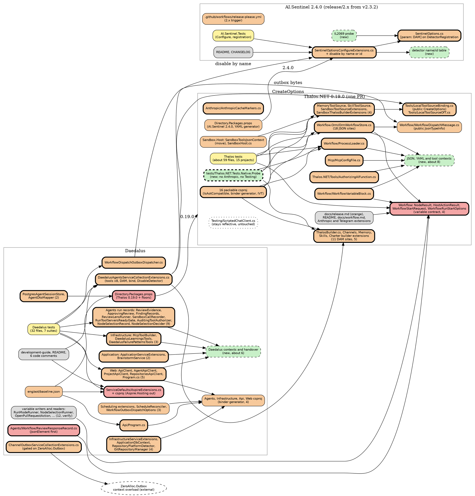

# Impact Analysis: Phase 3.2, our own reflection out

Input: `docs/superpowers/specs/2026-10-21-phase-3.2-reflection-out-design.md`, with the owner's decisions and the
controller's calls of 2026-10-21 (see "Decisions and corrections"). Branch `phase/3.2-reflection-out` at `2613708f`.
Thalos.NET read at `origin/main` `f515b2d` (v0.18.0+14) and at `v0.18.0`. AI.Sentinel read at `v2.3.2` and
`origin/main` `b32fa70` (v3.0.0+17). Analysis only: no code was changed and nothing was built, so every warning count
here is derived from code and from the 3.1 survey, and the Thalos plan re-counts first.

## Summary

| Metric | Value |
|---|---|
| Date | 2026-10-21 |
| Refactor Type | Change Interface (JSON contexts, the workflow variable contract, typed tool and options APIs, a name-based detector disable), Delete (reflection scans, suppressions, `AddServiceDefaults(IDistributedApplicationBuilder)`), Architectural (`IsAotCompatible` across Thalos, the binder and YAML generators, a native probe host) |
| Targets | 13, across 3 repos: Daedalus, Thalos.NET, AI.Sentinel |
| Directly Affected Files | 82 existing files: Thalos 40, AI.Sentinel 2, Daedalus 40 |
| Transitively Affected Files | 122 existing files: tests 92, verify-only callers 12, docs and comments 14, and 4 release files (Thalos' AI.Sentinel pin and release notes, AI.Sentinel's release workflow, the ratchet baseline) |
| Total | 204 existing files, plus about 19 new source files and the new golden, guard and probe tests |
| Breaking Changes | 7 files: Thalos 4 (the workflow variable entry points), Daedalus 3 (`AspireExtensions.cs`, `ReviewResponseRecord.cs`, `Directory.Packages.props`). AI.Sentinel 2.4.0 is additive |
| Risks Identified | 19 |
| Risk Level | High: more than 50 files and 5 high-severity risks (R1 to R5) |

Classification of the 204 existing files: **7 Breaking, 79 Update Required, 92 Test Impact, 26 Cosmetic or
verify-only.**

Targets:

1. **JSON contexts.** Every reflective `JsonSerializer` call in Thalos' and Daedalus' own code moves to a
   source-generated `JsonTypeInfo`, with options that match today's exactly.
2. **The workflow variable contract (Thalos, owner).** Variables accept JSON-shaped values only and are converted to
   `JsonElement` at the boundary. This is a breaking change in Thalos 0.19.0.
3. **Tool registration.** Thalos' Memory, Skills and Sandbox sources, Daedalus' eight Thalos tool classes and
   Daedalus' own `McpToolBuilder` move to explicit, typed binder lists.
4. **Configuration binder generator** in Thalos' Anthropic, Channels, Telegram, Memory and Skills, and Daedalus'
   Agents, Infrastructure, Api and Web.
5. **DI generic annotations:** `[DynamicallyAccessedMembers(PublicConstructors)]` on 11 Thalos builder generics and
   Daedalus' `ForwardHostedServiceToConcreteSingleton<T>`.
6. **YAML:** `ProcessLoader` on YamlDotNet's static generator.
7. **Suppressions out:** 5 `UnconditionalSuppressMessage` attributes and 9 `#pragma` sites in Daedalus.
8. **Mediator:** the generated `AddMediator(ServiceLifetime.Scoped)` replaces the `GetTypes()` handler scan.
9. **ServiceDefaults:** the unused `AddServiceDefaults(IDistributedApplicationBuilder)` and both Aspire.Hosting
   references go.
10. **AI.Sentinel 2.4.0:** a name- or id-based detector disable API and the IL2069 fix; Daedalus drops
    `GetExportedTypes` and `MakeGenericMethod`.
11. **`IsAotCompatible` on every packable Thalos project except Testing, and a native probe host.**
12. **The Thalos 0.19.0 bump in Daedalus**, with the floors it lifts.
13. **ZeroAlloc.Outbox's context overload**, a handover to the owner's ZeroAlloc session; Daedalus adopts it if it
    ships, or carries it as a named blocker.

Findings that change the plan:

- **Removing a suppression alone breaks the build in most projects.** Daedalus sets `TreatWarningsAsErrors` and
  `EnableTrimAnalyzer` for every project (`Directory.Build.props:7,38`). Only Api, Agents, Cli, Migrations and Web
  turn the analyzer off. Everywhere else a suppression comes out in the same commit as its fix. Of the analyzer-off
  projects, only Api holds a suppression: the assembly-level IL2026 at `Program.cs:29-31`.
- **The design misses two suppressions.** `IL2026` sits inside multi-code `#pragma` lists in
  `RepositoryPlatformDetector.cs:8,177` and `GitRepositoryManager.cs:11,549`. Neither file calls a
  `[RequiresUnreferencedCode]` member, so both look stale; the build proves it.
- **Two of the design's JSON items are already done.** `GlobalExceptionHandler.cs:42-46` and
  `AgentSessionsController.cs:207` already pass `ApiJsonSerializerContext` metadata. The Web project's real work is
  four clients, not one: `ApiClient`, `AgentApiClient`, `ProjectApiClient` and `RepositoriesApiClient`.
- **ZeroAlloc.Mediator's generator already emits handler registration**, with a
  `defaultHandlerLifetime` overload (strings in `ZeroAlloc.Mediator.Generator` 6.6.3). This settles the design's first
  open question.
- **The Cli binds no configuration**, so the binder generator goes on Web instead (`Web/Program.cs:186`).
- **ServiceDefaults holds no resource-name constants, and nothing calls its
  `AddServiceDefaults(IDistributedApplicationBuilder)`.** The AppHost does not reference ServiceDefaults. The member
  is deleted; nothing moves.
- **A typed `DisableDetector<T>` would not remove Daedalus' reflection**, because Daedalus disables detectors by
  configured name (`DaedalusAgentsOptions.cs:210`). AI.Sentinel's DAM is already on the `DetectorType` property
  (`SentinelOptions.cs:33-36` at v2.3.2); IL2069 comes from the unannotated constructor parameter.
- **AI.Sentinel's 2.x line has no release path today.** `release-please.yml` runs on `main` only, and v2.3.2 does
  not set `IsAotCompatible` (it arrived in 3.0's #365). The 2.x branch needs its own release trigger, and the IL2069
  fix needs an ILC or analyzer probe to prove it.
- **The typed tool path cannot match the reflective bytes without Thalos' help.** The options factory that mirrors the
  reflective path, `LocalToolSourceBinding.CreateOptions`, is `internal` (`LocalToolSourceBinding.cs:17,74-80`), and
  0.18.0's docs advise passing a context's own options, which differ in encoder, naming and null handling. Memory,
  Skills and Sandbox cannot reach `LocalToolSource<TTools>` either: it is internal and they have no
  `InternalsVisibleTo`.
- **Four typed sources may share one name.** `ToolSourceNames.AddLocal` refuses a clash with a remote source only,
  and `ToolCatalog` drops duplicate qualified tool names, first wins. So Daedalus' line 424, four classes under
  `daedalus`, becomes four typed calls under the same name. Verified at `origin/main`.
- **The variable contract reaches Daedalus' readers.** Eleven Daedalus files write or read run variables, and several
  read with `as string` or `is string` (`RunModeRunner.cs:88`, `NodeSelectionRunner.cs:243`,
  `FileReviewFindingsAction.cs:123`, `OpenPullRequestAction.cs:228`). If the converted `JsonElement` ever reaches
  `WorkflowRun.Variables`, those reads turn null silently. `WorkflowVariableBlock.RenderValue` also renders a `string`
  raw, but would quote a `JsonElement` string. See R3.
- **Stored byte identity cannot be tested on rows.** Every workflow and record column is `jsonb`, which Postgres
  normalises. Bytes are tested at the serializer output; rows get read tests. The one raw-bytes channel is the outbox
  payload, which Thalos writes at `OrmWorkflowStore.cs:1027` and Daedalus reads at
  `WorkflowDispatchOutboxDispatcher.cs:29`.

## Dependency Graph

Arrows point from a dependent to what it depends on. Red is Breaking, orange is Update Required, yellow is Test Impact
and gray is Cosmetic or verify-only. A bold border marks a target. New files are green and dashed. Files are grouped by
module; a node's label gives its file count where it holds more than one.

Discovery depth. Depth 1 holds the targets: every file with a reflection site, a suppression, a reflective scan, a
builder generic, a configuration bind or the API being changed. Depth 2 holds the following:

- Daedalus' variable writers and readers, through the Thalos variable contract.
- Daedalus' `DaedalusAgentsServiceCollectionExtensions.cs`, `WorkflowDispatchOutboxDispatcher.cs` and the package pins,
  through Thalos 0.19.0's public API and AI.Sentinel 2.4.0.
- Thalos.NET.Sentinel's pin, through AI.Sentinel 2.4.0.
- The tests of every changed file, the ratchet baseline and the docs.

The closure ends at depth 2:

- `ScriptedChatClient` stays reflective, so its 66 call sites are untouched: 37 in 6 Daedalus test files and 29 in 13
  Thalos test files.
- No public signature in Daedalus changes except the deleted `AddServiceDefaults(IDistributedApplicationBuilder)`,
  which has no caller.
- The Thalos builder generics take a DAM annotation, which is source- and binary-compatible for callers that pass
  concrete types, and Daedalus passes concrete types everywhere.

## Affected Files

Paths start with the repo: `D:` is Daedalus, `T:` is Thalos.NET under `src/` unless they say `tests/` or `docs/`, and
`S:` is AI.Sentinel on its `release/2.x` branch. Targets are numbered as in the Summary. Complexity is Trivial, Small,
Medium or Large.

| # | File | Classification | Change Required | Caused By | Complexity |
|---|---|---|---|---|---|
| 1 | T: Thalos.NET.Workflow/NodeResult.cs | Breaking | Variables accept JSON-shaped values only: string, number, bool, null, `JsonElement`/`JsonNode`, and lists or dictionaries of those. They convert to `JsonElement` for serialisation; any other type fails with an error naming the variable and its type | 2 | Medium |
| 2 | T: Thalos.NET.Workflow/HostActionResult.cs | Breaking | Same contract for host-action variables | 2 | Small |
| 3 | T: Thalos.NET.Workflow/WorkflowStartRequest.cs | Breaking | Same contract for `InitialVariables` | 2 | Small |
| 4 | T: Thalos.NET.Workflow/WorkflowRunStartOptions.cs | Breaking | Same contract for `Variables` | 2 | Small |
| 5 | D: src/Daedalus.ServiceDefaults/AspireExtensions.cs | Breaking | Delete the public `AddServiceDefaults(IDistributedApplicationBuilder)` at `:58-63` and `using Aspire.Hosting;` at `:1`. No caller | 9 | Trivial |
| 6 | D: src/Daedalus.Agents/Workflow/ReviewResponseRecord.cs | Breaking | `ToPayloadJson(object?)` at `:37-38` converts the value to `JsonElement` first, then serialises a `Dictionary<string, JsonElement>` through a context. Signature unchanged | 1 | Small |
| 7 | D: Directory.Packages.props | Breaking | 18 `Thalos.NET*` pins 0.18.0 to 0.19.0; `Anthropic` 12.58.0 to 12.60.0; `ZeroAlloc.ORM` 2.4.0 to 2.4.1; `ModelContextProtocol` to whatever 0.19.0's nuspec floors; Rag.NET 1.1.3 and AI.Sentinel 2.4.0 arrive transitively. History comment per pin | 12 | Small |
| 8 | T: Thalos.NET.Workflow.Orm/OrmWorkflowStore.cs | Update Required | 18 sites onto an internal context pair: default options for visits, variables and the outbox payload; Web options for manifest, principal, usage and resume envelope. Resume variables at `:460` go through the target 2 converter | 1, 2 | Large |
| 9 | T: Thalos.NET.Workflow/WorkflowVariableBlock.cs | Update Required | The 5 `Serialize(object)` sites at `:403-451` render from the context. A `JsonElement` string renders raw, as a `string` does today, so the prompt bytes stay identical | 1, 2 | Medium |
| 10 | T: Thalos.NET.Workflow/WorkflowDispatchMessage.cs | Update Required | Expose a public `JsonTypeInfo<WorkflowDispatchMessage>` with today's default options, so Daedalus reads the payload with Thalos' own metadata | 1 | Small |
| 11 | T: Thalos.NET.Workflow/ProcessLoader.cs | Update Required | `StaticDeserializerBuilder` with a `[YamlStaticContext]`; the private nested DTOs at `:121-142` become internal | 6 | Medium |
| 12 | T: Thalos.NET.Anthropic/AnthropicCacheMarkers.cs | Update Required | The 4 `SerializeToElement` sites at `:84-105` walk the SDK's raw JSON members. Re-check `RawData` and `RawBodyData` in 12.60.0 | 1 | Medium |
| 13 | T: Thalos.NET.Mcp/McpConfigFile.cs | Update Required | Context with Web defaults, `ReadCommentHandling=Skip`, `AllowTrailingCommas`; `TimeSpan` "c" format kept | 1 | Small |
| 14 | T: Thalos.NET/Tools/AuthorizingAIFunction.cs | Update Required | `GetTypeInfo(typeof(IDictionary<string,object?>))` from a resolver that combines M.E.AI's context with a Thalos one | 1 | Small |
| 15 | T: Thalos.NET/Tools/LocalToolSourceBinding.cs | Update Required | `CreateOptions(IJsonTypeInfoResolver)` becomes public, or a public equivalent (controller's call) | 3 | Small |
| 16 | T: Thalos.NET/Tools/LocalToolSourceOfT.cs | Update Required | Reachable from Memory, Skills and Sandbox: a public factory or `InternalsVisibleTo`. The `LayeringTests` `MethodInfo` rule keys on the `LocalToolSource` name | 3 | Small |
| 17 | T: Thalos.NET/ThalosBuilder.cs | Update Required | DAM on `AddPolicy`, `UseChatClientProvider`, `AddChatClientDecorator`, `AddToolSource`, `UseSessionStore` | 5 | Trivial |
| 18 | T: Thalos.NET.Channels/ChannelThalosBuilderExtensions.cs | Update Required | DAM on `UseConversationMap`; `Bind` at `:42` intercepted by the generator | 4, 5 | Trivial |
| 19 | T: Thalos.NET.Memory/MemoryThalosBuilderExtensions.cs | Update Required | DAM on `UseMemoryStore` and `UseMemoryIndex`; RUC/RDC off both `UseMemory`; `Bind` at `:48` intercepted | 3, 4, 5 | Small |
| 20 | T: Thalos.NET.Memory/MemoryToolSource.cs | Update Required | Typed source over `MemoryTools`; RUC/RDC off the constructor | 3 | Small |
| 21 | T: Thalos.NET.Skills/SkillThalosBuilderExtensions.cs | Update Required | DAM on `UseSkillStore` and `UseSkillIndex`; RUC/RDC off both `UseSkills`; `Bind` at `:60` intercepted | 3, 4, 5 | Small |
| 22 | T: Thalos.NET.Skills/SkillToolSource.cs | Update Required | Typed source over `SkillTools`; RUC/RDC off the constructor | 3 | Small |
| 23 | T: Thalos.NET.Skills/Charters/CharterThalosBuilderExtensions.cs | Update Required | DAM on `UseRoleCharterStore`; `Get<List<string>>` at `:52` intercepted | 4, 5 | Trivial |
| 24 | T: Thalos.NET.Sandbox/SandboxToolSourceExtensions.cs | Update Required | Public `AddRemoteRunTools<TTools>(name, JsonSerializerOptions, params Func<TTools,Delegate>[])`; the `Type` overload keeps RUC | 3 | Medium |
| 25 | T: Thalos.NET.Sandbox/SandboxThalosBuilderExtensions.cs | Update Required | `UseSandboxRunWorkspaces` uses the typed overload; RUC/RDC off | 3 | Small |
| 26 | T: Thalos.NET.Sandbox.Host/SandboxToolsJsonContext.cs | Update Required | Move into Thalos.NET.Sandbox, so the remote schemas and the host's live tools share one binder list | 3 | Small |
| 27 | T: Thalos.NET.Sandbox.Host/SandboxHost.cs | Update Required | Reference the moved context | 3 | Trivial |
| 28 | T: 16 packable `*.csproj` (all but Testing and the already-on Sandbox.Host) | Update Required | `IsAotCompatible=true`, one project per commit; `EnableConfigurationBindingGenerator` in Anthropic, Channels, Telegram, Memory, Skills; `InternalsVisibleTo` in Thalos.NET.csproj if row 16 takes that route | 4, 11 | Medium |
| 29 | T: Directory.Packages.props | Update Required | AI.Sentinel 2.3.2 to 2.4.0; add the YamlDotNet static generator package | 6, 10 | Trivial |
| 30 | T: docs/release.md | Update Required | 0.19.0 section: the breaking variable contract, public `CreateOptions`, `AddRemoteRunTools<T>`, removed RUC | 2, 3 | Small |
| 31 | S: src/AI.Sentinel/SentinelOptions.cs | Update Required | `[param: DynamicallyAccessedMembers(PublicConstructors)]` on `DetectorRegistration`'s `DetectorType` at `:33-36` | 10 | Trivial |
| 32 | S: src/AI.Sentinel/SentinelOptionsConfigureExtensions.cs | Update Required | Additive disable by detector type name or `DetectorId`, over a static table of the official detectors; unknown name fails with a clear error | 10 | Medium |
| 33 | S: .github/workflows/release-please.yml (and the manifest) | Update Required | Run release-please on `release/2.x` so 2.4.0 can release from it | 10 | Small |
| 34 | D: src/Daedalus.Api/Program.cs | Update Required | Drop the assembly IL2026 suppression `:29-31` and its now-unused `using`; `:48-49`, `:159`, `:189` binds go through the generator | 4, 7 | Small |
| 35 | D: src/Daedalus.Application/Extensions/ApplicationServiceExtensions.cs | Update Required | Delete `RegisterHandlersAot` `:64-106` with its 3 suppressions; `AddMediator(ServiceLifetime.Scoped)` at `:39`; drop the call at `:29` | 7, 8 | Small |
| 36 | D: src/Daedalus.Infrastructure/Persistence/ApplicationDbContext.cs | Update Required | Drop the `[method:]` IL2026 suppression `:15-17`. Verify by build: if IL2026 fires, the honest form is `[RequiresUnreferencedCode]` on the constructor until 3.5 | 7 | Small |
| 37 | D: src/Daedalus.Infrastructure/Agents/McpToolBuilder.cs | Update Required | Explicit typed binder list for the two `[McpServerToolType]` classes; options = M.E.AI defaults with a context resolver; keep names, descriptions and order; the 3 pragmas `:180-182` go | 3, 7 | Medium |
| 38 | D: src/Daedalus.Infrastructure/Agents/Tools/DaedalusLearningsTools.cs | Update Required | Anonymous result to a record; context with `WriteIndented`; drop pragma `:1` | 1, 7 | Small |
| 39 | D: src/Daedalus.Infrastructure/Agents/Tools/DaedalusFailurePatternsTools.cs | Update Required | Same; its result also reaches Thalos through `DaedalusKnowledgeTools` | 1, 7 | Small |
| 40 | D: src/Daedalus.Application/Services/Brainstorm/BrainstormService.cs | Update Required | Context with case-insensitive names and string enums that still accept integers; drop pragma `:1` | 1, 7 | Small |
| 41 | D: src/Daedalus.Infrastructure/Extensions/InfrastructureServiceExtensions.cs | Update Required | The 3 binds `:54`, `:86-87`, `:192` go through the generator; their pragmas go in the same commit | 4, 7 | Small |
| 42 | D: src/Daedalus.Infrastructure/Services/CodeAnalysis/RepositoryPlatformDetector.cs | Update Required | Drop `IL2026` from the pragma lists at `:8` and `:177`; keep the other codes | 7 | Trivial |
| 43 | D: src/Daedalus.Infrastructure/Services/CodeAnalysis/GitRepositoryManager.cs | Update Required | Drop `IL2026` from `:11` and `:549` | 7 | Trivial |
| 44 | D: src/Daedalus.Agents/Workflow/ReviewEvidence.cs | Update Required | Web-defaults context: case-insensitive, numbers readable from strings | 1 | Small |
| 45 | D: src/Daedalus.Agents/Workflow/ApprovingReview.cs | Update Required | Same context | 1 | Trivial |
| 46 | D: src/Daedalus.Agents/Workflow/SandboxCallRecorder.cs | Update Required | Anonymous payload to a record; `exit` stays a string for `OpenPullRequestAction.cs:354-356` | 1 | Small |
| 47 | D: src/Daedalus.Agents/Workflow/FindingRecords.cs | Update Required | 3 anonymous payloads to records | 1 | Small |
| 48 | D: src/Daedalus.Agents/Workflow/ReviewLensRunner.cs | Update Required | Anonymous evidence payload to a record; `checked` needs its explicit name | 1 | Small |
| 49 | D: src/Daedalus.Agents/Security/AuditingToolAuthorizer.cs | Update Required | Anonymous payload to a record | 1 | Trivial |
| 50 | D: src/Daedalus.Agents/Workflow/RunToolServersReadyGate.cs | Update Required | Anonymous payload to a record | 1 | Trivial |
| 51 | D: src/Daedalus.Agents/Workflow/WorkflowDispatchOutboxDispatcher.cs | Update Required | Read with Thalos 0.19.0's public `JsonTypeInfo<WorkflowDispatchMessage>` | 1, 12 | Trivial |
| 52 | D: src/Daedalus.Agents/Api/AgentDtoMapper.cs | Update Required | `GetTypeInfo(typeof(IDictionary<string,object?>))` on the M.E.AI options it uses today | 1 | Trivial |
| 53 | D: src/Daedalus.Agents/Workflow/NodeSelectionRecord.cs | Update Required | Context; private nested records become internal | 1 | Small |
| 54 | D: src/Daedalus.Agents/Decisions/NodeSelectionDecider.cs | Update Required | Context for `DecisionState`, the wire state to Minos | 1 | Small |
| 55 | D: src/Daedalus.Agents/Sessions/PostgresAgentSessionStore.cs | Update Required | `GetTypeInfo(typeof(ChatMessage))` on its existing M.E.AI options | 1 | Small |
| 56 | D: src/Daedalus.Agents/DaedalusAgentsServiceCollectionExtensions.cs | Update Required | Typed `AddLocalTools<T>` for the 8 tool classes with `CreateOptions`; DAM on `ForwardHostedServiceToConcreteSingleton<T>` `:993`; binds `:167,223,1665,1688` through the generator; `DisableDetector` `:1950-1963` on AI.Sentinel 2.4.0's name API | 3, 4, 5, 10 | Large |
| 57 | D: src/Daedalus.Agents/DaedalusSchedulingServiceCollectionExtensions.cs | Update Required | `Configure<T>(section)` at `:82`, `:100` intercepted | 4 | Trivial |
| 58 | D: src/Daedalus.Agents/Workflow/WorkflowOutboxDispatchOptions.cs | Update Required | `Bind` at `:116` intercepted | 4 | Trivial |
| 59 | D: src/Daedalus.Agents/Scheduling/ScheduleReconciler.cs | Update Required | `Get<List<ScheduledRunOptions>>`, `Get<string[]>` intercepted | 4 | Trivial |
| 60 | D: src/Daedalus.Agents/Channels/ChannelOutboxServiceCollectionExtensions.cs | Update Required | `WithSystemTextJsonSerializer` at `:103` takes a context; gated on the ZeroAlloc.Outbox release | 13 | Small |
| 61 | D: src/Daedalus.Web/Services/ApiClient.cs | Update Required | `JsonTypeInfo` overloads; private helpers generic over `TBody`; `new { }` bodies become an `EmptyBody` record | 1 | Medium |
| 62 | D: src/Daedalus.Web/Services/AgentApiClient.cs | Update Required | Web-defaults context | 1 | Small |
| 63 | D: src/Daedalus.Web/Services/ProjectApiClient.cs | Update Required | Same | 1 | Small |
| 64 | D: src/Daedalus.Web/Services/RepositoriesApiClient.cs | Update Required | Same | 1 | Small |
| 65 | D: src/Daedalus.Web/Program.cs | Update Required | `Configuration.Bind("Oidc", …)` at `:186` intercepted | 4 | Trivial |
| 66 | D: src/Daedalus.ServiceDefaults/Daedalus.ServiceDefaults.csproj | Update Required | Drop `Aspire.Hosting` and `Aspire.Hosting.PostgreSQL` | 9 | Trivial |
| 67 | D: src/Daedalus.Agents/Daedalus.Agents.csproj | Update Required | `EnableConfigurationBindingGenerator` | 4 | Trivial |
| 68 | D: src/Daedalus.Infrastructure/Daedalus.Infrastructure.csproj | Update Required | Same | 4 | Trivial |
| 69 | D: src/Daedalus.Api/Daedalus.Api.csproj | Update Required | Same; update the comment at `:10-13` | 4 | Trivial |
| 70 | D: src/Daedalus.Web/Daedalus.Web.csproj | Update Required | Same | 4 | Trivial |
| 71 | D: eng/aot/baseline.json | Update Required | Rewritten per target in every commit that moves a count, with its cause | all | Trivial |
| 72 | T: tests, about 59 files in 15 projects: Workflow.Orm (16), Workflow.Orm.Host, Workflow (6 for the variable block, 11 for `ProcessLoader`), Mcp, Unit (`AuthorizingAIFunction` 3, `AddLocalTools` 5, `LocalToolSource` 3, Layering), Sandbox (`AddRemoteRunTools` 2, `UseSandboxRunWorkspaces` 3), Sandbox.Docker (2), Memory (4), Skills (4) | Test Impact | Golden bytes captured before each swap; golden-row reads; tool oracle per source; binder equality; YAML equality; tests for the variable contract's refusals | 1-6 | Large |
| 73 | S: tests/AI.Sentinel.Tests (Configure and registration tests) | Test Impact | Name and id disable, unknown-name error, `AddDetector<T>` reachability | 10 | Small |
| 74 | D: tests/Daedalus.Tests.Unit.Application/Agents/DaedalusKnowledgeToolsTests.cs | Test Impact | Reflective `LocalToolSource` stays as the oracle; add the typed path | 3 | Small |
| 75 | D: tests/Daedalus.Tests.Integration/Agents/DaedalusScheduleToolsTests.cs | Test Impact | Same | 3 | Small |
| 76 | D: tests/Daedalus.Tests.Integration/Agents/ManufactureStartToolTests.cs | Test Impact | `:131` moves to the shipped typed registration | 3 | Small |
| 77 | D: tests/Daedalus.Tests.Unit.Application/Agents/DaedalusAgentsRegistrationTests.cs | Test Impact | `:437`, `:808`: disable by name and the unknown-name message; `:252` tool sources | 3, 10 | Small |
| 78 | D: tests/Daedalus.Tests.Unit.Application/Extensions/ApplicationServicesRunStatusFallbackTests.cs | Test Impact | Handler resolution after the generated registration | 8 | Trivial |
| 79 | D: tests/Daedalus.Tests.Playwright.Browser/Fixtures/E2EServerFixture.cs | Test Impact | Calls `AddApplicationServices`; e2e | 8 | Trivial |
| 80 | D: tests/Daedalus.Tests.Integration/Workflow/TelemetryEndToEndTests.cs | Test Impact | Reflects on the `AspireExtensions` field names at `:79`; must keep passing | 9 | Trivial |
| 81 | D: tests/Daedalus.Tests.Unit/Decisions/DecisionWiringTests.cs | Test Impact | Same, at `:321` | 9 | Trivial |
| 82 | D: tests/Daedalus.Tests.Unit/Workflow/NodeSelectionRecordTests.cs | Test Impact | Golden bytes | 1 | Small |
| 83 | D: tests/Daedalus.Tests.Unit/Workflow/FindingRecordsTests.cs | Test Impact | Golden bytes | 1 | Small |
| 84 | D: tests/Daedalus.Tests.Unit/Workflow/ReviewResponseRecordingTests.cs | Test Impact | Golden bytes for every value shape a node can report | 1, 2 | Small |
| 85 | D: tests/Daedalus.Tests.Unit/Workflow/SandboxCallRecorderTests.cs | Test Impact | Golden bytes | 1 | Small |
| 86 | D: tests/Daedalus.Tests.Unit/Workflow/ApprovingReviewTests.cs | Test Impact | Lenient reads, `"line":"12"` | 1 | Small |
| 87 | D: tests/Daedalus.Tests.Unit/Workflow/RunToolServersReadyGateTests.cs | Test Impact | Payload bytes | 1 | Trivial |
| 88 | D: tests/Daedalus.Tests.Integration/Workflow/RunToolServersReadyGateTests.cs | Test Impact | Payload | 1 | Trivial |
| 89 | D: tests/Daedalus.Tests.Integration/Agents/WriteAuditTests.cs | Test Impact | Audit payload | 1 | Trivial |
| 90 | D: tests/Daedalus.Tests.Unit/Decisions/NodeSelectionDeciderTests.cs | Test Impact | Minos state JSON | 1 | Small |
| 91 | D: tests/Daedalus.Tests.Unit.Application/Agents/AgentDtoMapperTests.cs | Test Impact | Argument JSON bytes | 1 | Small |
| 92 | D: tests/Daedalus.Tests.Integration/Agents/PostgresAgentSessionStoreTests.cs | Test Impact | Read test over an existing `ContentJson` row | 1 | Small |
| 93 | D: tests/Daedalus.Tests.Integration/Workflow/WorkflowOutboxDispatchEndToEndTests.cs | Test Impact | Outbox payload bytes, Thalos to Daedalus | 1, 12 | Small |
| 94 | D: tests/Daedalus.Tests.Unit.Infrastructure/Agents/DaedalusLearningsToolsTests.cs | Test Impact | Result bytes | 1, 3 | Small |
| 95 | D: tests/Daedalus.Tests.Unit.Infrastructure/Agents/FrozenHistoryToolTests.cs | Test Impact | Descriptions and results | 3 | Small |
| 96 | D: tests/Daedalus.Tests.Unit.Application/Services/Brainstorm/BrainstormServiceGenerateTasksTests.cs | Test Impact | Enum input as names, as other-case names and as integers | 1 | Small |
| 97 | D: tests/Daedalus.Tests.Unit/Web/ProjectApiClientTests.cs | Test Impact | Request and response bytes | 1 | Small |
| 98 | D: tests/Daedalus.Tests.Unit/Web/RepositoriesApiClientTests.cs | Test Impact | Same | 1 | Small |
| 99 | D: tests/Daedalus.Tests.Unit/Web/RecordingHandler.cs | Test Impact | Shared fixture | 1 | Trivial |
| 100 | D: tests/Daedalus.Tests.Unit/Web/SessionExpiryTests.cs | Test Impact | Web clients | 1 | Trivial |
| 101 | D: tests/Daedalus.Tests.Unit/Web/ResilienceRejectionTests.cs | Test Impact | Web clients | 1 | Trivial |
| 102 | D: tests/Daedalus.Tests.Unit.Infrastructure/Extensions/ClaudeConfigurationBindingTests.cs | Test Impact | Generator bind equals reflective bind | 4 | Small |
| 103 | D: tests/Daedalus.Tests.Integration/Api/GitHubOptionsTests.cs | Test Impact | Same, `TimeSpan` | 4 | Small |
| 104 | D: tests/Daedalus.Tests.Integration/Scheduling/ScheduleReconcilerTests.cs | Test Impact | `Get<List<ScheduledRunOptions>>` | 4 | Small |
| 105 | D: tests/Daedalus.Tests.Unit/Configuration/ApiThalosConfigurationTests.cs | Test Impact | `DaedalusAgentsOptions` binding, append semantics and the double bind | 4 | Small |
| 106 | T: README.md, docs/workflow.md, Anthropic and Telegram builder extensions | Cosmetic | README `:265` shows the typed form; the two `.cs` files need no source change once the generator intercepts | 3, 4 | Trivial |
| 107 | S: README.md, CHANGELOG.md | Cosmetic | The name API; release-please writes the changelog | 10 | Trivial |
| 108 | D: src/Daedalus.Agents/Tools/DaedalusReviewTools.cs | Cosmetic | `:45-51` comment on reflective discovery | 3 | Trivial |
| 109 | D: src/Daedalus.Api/ApiJsonSerializerContext.cs | Cosmetic | Remarks `:13-17` | 1 | Trivial |
| 110 | D: src/Daedalus.Agents/Scheduling/ScheduledRunStore.cs | Cosmetic | `:28` names `AspireExtensions`; still true | 9 | Trivial |
| 111 | D: src/Daedalus.Agents/DaedalusAgentsOptions.cs, Workflow/SquadOptions.cs | Cosmetic | Binder remarks `:39-48` and `:8`; keep if the generator appends the same | 4 | Trivial |
| 112 | D: tests/Daedalus.Tests.Unit/ContentResyncServiceTests.cs | Cosmetic | Doc mention `:450` | 5 | Trivial |
| 113 | D: docs/development-guide.md, README.md | Cosmetic | Contexts, generators, ServiceDefaults, the variable contract | all | Small |
| 114 | D: variable writers and readers: Workflow/ManufactureRunStarter.cs, WorkflowRunModeStore.cs, ReviewHandoff.cs, OpenPullRequestAction.cs, RunModeRunner.cs, NodeSelectionRunner.cs, FileReviewFindingsAction.cs, PullRequestLink.cs, StandingInstructionsWriter.cs, ReviewHandoffWorkflowStore.cs, ReviewResponseRecorder.cs, and Application/DTOs/WorkflowRuns/WorkflowRunViews.cs | Cosmetic or verify-only | Writers pass only strings and plain values today, so they meet the contract. Readers use `as string`, `is string` and `ToString()`, so they must keep seeing today's CLR shapes. No change if R3's mitigation holds | 2 | Small |

New files, not counted above:

- Thalos: `Workflow/WorkflowJsonContext.cs`, `Workflow.Orm/WorkflowOrmJsonContext.cs`, `Mcp/McpConfigJsonContext.cs`,
  `Thalos.NET/Tools/ToolArgumentsJsonContext.cs`, `Memory/MemoryToolsJsonContext.cs`,
  `Skills/SkillToolsJsonContext.cs`, `Workflow/ProcessYamlContext.cs`, the variable converter, and
  `tests/Thalos.NET.Tests.Native.Probe/` with its test.
- AI.Sentinel: the detector name and id table, and an IL2069 probe that reaches `AddDetector<T>()`.
- Daedalus: `DaedalusRecordsJsonContext.cs` (and a Web-options reader context), `DaedalusToolsJsonContext.cs`,
  `McpToolsJsonContext.cs`, `BrainstormJsonContext.cs`, `WebJsonContext.cs`, and
  `docs/plans/2026-10-21-zeroalloc-outbox-serializer-handover.md`.
- Tests: the tool guards (names, descriptions, `JsonSchema`, `ReturnJsonSchema` and result bytes, plus a test that
  fails on an unlisted tool method), the handler-set equality test, binder equality per options type, and golden-byte
  tests per serialised type.

Out of 3.2, handed on:

- About 45 MVC anonymous error bodies in `Daedalus.Api/Controllers`, for 3.4.
- Web's JSInterop `Invoke<T>` in `MainLayout.razor:168` and `Tasks.razor:243`, for 3.7.
- SignalR's reflection fallback (`Program.cs:153-154`, `RunHubConnection.cs:213`).
- `ScriptedChatClient`, which stays reflective.
- AI.Sentinel's opt-in `AuthorizationChatClient` suppressions, which neither Thalos nor Daedalus wires.
- AI.Sentinel 3.x (Thalos#364), a separate change.

## Risk Register

| # | Risk | Affected Files | Severity | Mitigation |
|---|---|---|---|---|
| R1 | **A context's options differ subtly from the reflective ones**: encoder (default vs `UnsafeRelaxedJsonEscaping`), naming, null handling, enum format, number handling. Stored rows stop reading, or the API, SSE, tool and prompt bytes change | rows 8-14, 34-55, 61-64 | High | Golden bytes captured from the reflective path before each swap and committed with the test, per type and per options set. Each context's options are read off its site, as listed in the reports. A `Red:` line per assertion, seen failing once |
| R2 | **Tool schemas and result bytes drift on the typed path.** `CreateOptions` is internal, and 0.18.0's docs advise a context's own options. A change reaches the model's tool list and prompt cache | rows 15-16, 19-27, 37-39, 56 | High | Thalos 0.19.0 makes `CreateOptions` public, and every typed source uses it (controller's call). The guard compares name, description, `JsonSchema`, `ReturnJsonSchema` and the invocation result bytes with the reflective oracle, for every Thalos and Daedalus source |
| R3 | **The variable contract changes what consumers see.** If the converted `JsonElement` reaches `WorkflowRun.Variables`, Daedalus' `as string` and `is string` reads turn null silently. `RenderValue` renders a `string` raw but would quote a `JsonElement` string. A third-party consumer passing a Guid, record or enum now fails | rows 1-4, 8-9, 114 | High | Convert to `JsonElement` for serialisation only. Values exposed through `WorkflowRun.Variables` keep the CLR shapes that `WorkflowVariableBlock.ReadObject` returns. Golden prompt-block bytes per allowed type, before and after. A Thalos test that a run's variables keep their CLR types after start, node result and resume. A test per refused type with the error text. Documented as breaking in 0.19.0 |
| R4 | **An open `object` that only fails natively.** Under source generation an unregistered runtime type throws `NotSupportedException` on native only, while JIT stays green: `ReviewResponseRecord`, `AuthorizingAIFunction` with POCO arguments, `ChatMessage.AdditionalProperties`, tool-call `Arguments` | rows 6, 14, 52, 55 | High | `ReviewResponseRecord` converts to `JsonElement` first (controller's call). The probe invokes `AuthorizingAIFunction` with `JsonElement` arguments. Test every value shape a node can report |
| R5 | **AI.Sentinel 2.4.0 cannot release from a branch.** `release-please.yml` triggers on `main` only, and the 2.x branch inherits that. v2.3.2 has no `IsAotCompatible`, so its CI never sees IL2069, and the aot-publish CLIs never reach `AddDetector<T>`. Thalos 0.19.0 waits on 2.4.0 | rows 29, 31-33, 56 | High | Settle the 2.x release mechanics first: release-please with `release/2.x` as its target branch, or a manual tag the owner approves. Prove IL2069 with a probe that calls `AddDetector<T>()` under ILC, or a throwaway analyzer build. Do not turn `IsAotCompatible` on in 2.x, which would widen the scope. If it slips, Daedalus carries the reflection as a named blocker |
| R6 | **Removing a suppression alone breaks the build** in analyzer-on projects under `TreatWarningsAsErrors`. An unused `using` left behind also fails, through IDE0005 | rows 34-43 | Medium | Each suppression comes out in the same commit as its fix (controller's call). Only Api takes a bare removal, with an upward re-baseline and its cause |
| R7 | **Lenient readers lose their leniency.** `ReviewEvidence` and `ApprovingReview` read numbers from strings, case-insensitively; `BrainstormService` reads enum names in any case and integers. Model output starts failing | rows 40, 44-45 | Medium | Context options or attributes that match today's exactly (controller's call). Golden tests over the lenient inputs: `"line":"12"`, other-case names, integer enums |
| R8 | **jsonb normalises the stored bytes**, so a byte test on a row proves nothing, and the outbox payload crosses two repos | rows 8, 10, 51, 92-93 | Medium | Bytes are tested at the serializer output. Stored rows get read tests over existing JSON. The outbox payload is tested byte for byte on both sides (controller's call) |
| R9 | **Binder generator semantics differ in edge cases**: get-only collections that append (`CharterRoots`, `DisabledDetectors`, `SkillOptions.Roots`), the get-only `AnthropicOptions.PromptCaching`, `TimeSpan?`, the double bind of `DaedalusAgentsOptions` (`Program.cs:159` and `:167`). An unsupported type is a SYSLIB110x error | rows 18-23, 28, 34, 41, 56-59, 65 | Medium | One equality test per options type against the reflective binder, including the append and double-bind cases |
| R10 | **The YamlDotNet static generator may not cover the process format.** `Vecc.YamlDotNet.Analyzers.StaticGenerator` 18.1.0 is unverified on nuget.org; `int?`, dictionaries and private nested DTOs are fragile. ILC may still report IL3050 inside YamlDotNet's `TypeConverter.ChangeType`, which would fail the probe | rows 11, 29 | Medium | Build the static context first. On any generator or SYSLIB error, stop and report with the exact warning and a fix at its source. YAML equality over Daedalus' two process files and the inline fixtures |
| R11 | **Anthropic 12.60.0 is unverified.** New `[RequiresUnreferencedCode]` or `[RequiresDynamicCode]` on SDK members would make Thalos.NET.Anthropic unable to reach zero under `IsAotCompatible`. The raw-JSON member names `AnthropicCacheMarkers` would walk may have moved | rows 12, 28 | Medium | Check 12.60.0's annotations and members in the re-count step, before any Anthropic change. On a block, stop and report |
| R12 | **The native probe's zero-warning claim** fails if it roots Anthropic or Testing, or if a rooted third-party assembly warns | probe | Medium | The probe leaves out Thalos.NET.Anthropic and Thalos.NET.Testing and asserts zero warnings from the assemblies it roots (controller's call). It uses a local fake `IChatClient`. Anthropic configuration binding is tested on JIT only |
| R13 | **Tool order and duplicates.** `McpToolBuilder` follows `GetTypes()` order, and every `"local"` entry gets all tools. Four typed sources under `daedalus` register in call order, and the catalog keeps the first duplicate qualified name. Order reaches the prompt and its cache | rows 37, 56 | Medium | Pin today's order and the duplicate behaviour in the guard |
| R14 | **Release coupling.** Thalos 0.19.0 needs AI.Sentinel 2.4.0 first and two owner merges; Daedalus' gated groups wait on both, and on ZeroAlloc.Outbox | rows 7, 29, 51, 56, 60 | Medium | Run the 0.18.0 groups first. AI.Sentinel goes in parallel with the Thalos PR's early steps. Anything unreleased at the end of 3.2 is carried as a named blocker in the rulings and STATE |
| R15 | **Ratchet attribution.** The 0.19.0 bump moves Anthropic 12.58 to 12.60, which shifts the 14,948-warning SDK group, plus MCP, ORM and Rag.NET | rows 7, 71 | Medium | The bump gets its own commit and its own re-baseline, with that cause alone (controller's call) |
| R16 | **`ApplicationDbContext`'s suppression** may be stale, or it may hide a real IL2026 in an analyzer-on project | row 36 | Medium | Drop it and build. If IL2026 fires, put `[RequiresUnreferencedCode]` on the constructor, which is honest until 3.5 removes EF Core; not `WarningsNotAsErrors` |
| R17 | **Implicit coupling.** Tests reflect on `AspireExtensions`' private `TracedSources` and `Meters`; policies and appsettings name `daedalus__*` and `git__*` tools; `OpenPullRequestAction` needs a string `exit` | rows 5, 46, 56, 80-81 | Low | Keep every name and field. Add a test on the test-result payload reader |
| R18 | **New public Thalos API** (`CreateOptions`, `AddRemoteRunTools<T>`, typed source access) meets `LayeringTests`' rule that allows `MethodInfo` only in types named `LocalToolSource` or `DefaultToolAuthorizer` | rows 15-16, 24 | Low | Keep the name, or bring the rule to the owner for a ruling |
| R19 | **Mediator lifetime.** The generated registration uses `TryAdd`, so anything registered earlier wins | row 35 | Low | `AddMediator(ServiceLifetime.Scoped)`; a test that the resolved handler set and lifetimes equal the old scan's |

Searches that found nothing:

- No other `UnconditionalSuppressMessage`, `SuppressMessage("Trim"…)`, IL `NoWarn`, `WarningsNotAsErrors`,
  `[RequiresUnreferencedCode]` or `[RequiresDynamicCode]` in Daedalus `src/`.
- No configuration binding in `Daedalus.Cli`.
- No caller of `AddServiceDefaults(IDistributedApplicationBuilder)`, and no resource-name constant in ServiceDefaults.
- No other public Thalos generic that reaches DI: the 11 IL2091 sites match the survey's 11.
- No YAML anchors, aliases, merge keys or tags in `processes/*.yaml`.
- No direct AI.Sentinel reference in Daedalus; it arrives through Thalos.NET.Sentinel.

## Execution Order

Groups 1 and 3 can start at once. Group 2 needs Group 1's release only at its step 9. Group 4 waits on Thalos
0.19.0, which carries AI.Sentinel 2.4.0, and its last item waits on ZeroAlloc.Outbox. Every commit builds green under
`TreatWarningsAsErrors`. Every count change runs `eng/aot/count-warnings.sh --target X --write` and commits the
baseline with its cause.

### Group 1: AI.Sentinel 2.4.0, branched from v2.3.2 (first, or in parallel)

1. Branch `release/2.x` from `v2.3.2`. Make release-please run on it, or agree a manual tag with the owner (R5).
   **Checkpoint:** a dry run shows 2.4.0 as the next version.
2. `[param: DynamicallyAccessedMembers(PublicConstructors)]` on `DetectorRegistration`, with a probe that calls
   `AddDetector<T>()` under ILC and asserts no IL2069. Red: remove the parameter attribute. **ATOMIC.**
3. Additive disable by type name or `DetectorId`, over a static table of the official detectors. An unknown name fails
   with a clear error. Tests for both keys and the error.
4. **Checkpoint:** AI.Sentinel suite green; PR; **owner merges**; **owner releases 2.4.0**.

### Group 2: the Thalos PR, released as 0.19.0

1. Re-count with a throwaway `-p:IsAotCompatible=true` build, which is not committed. Check Anthropic 12.60.0's
   annotations and the YAML generator package. **Checkpoint:** counts match the expected 78, plus 8 hidden behind RUC,
   or are explained; stop and report on any third-party block.
2. Goldens first, on the reflective code, in test-only commits: serializer bytes for every JSON site and options set,
   the outbox payload bytes, rows written by 0.18.0 code, tool dumps with result bytes for Memory, Skills, Workspace,
   Sandbox and the remote sources, bound-options dumps, and `ProcessDefinition` dumps for Daedalus' two process files
   and the inline fixtures. **Checkpoint:** green on unchanged code; a `Red:` line per assertion; commit.
3. DAM annotations on the 11 builder generics in 5 files. **Checkpoint:** build and unit tests; commit.
4. The binder generator in Anthropic, Channels, Telegram, Memory and Skills. It must land before step 7, which exposes
   the Memory and Skills binds. **Checkpoint:** binder equality tests; commit.
5. The variable contract and the Workflow plain-value context, in one commit, since the renderer and the store depend
   on both (R3). **ATOMIC.** **Checkpoint:** prompt-block goldens, the CLR-shape test, a refusal test per type; commit.
6. JSON contexts: Workflow.Orm (default and Web), the public dispatch `JsonTypeInfo`, Mcp, `AuthorizingAIFunction` and
   `AnthropicCacheMarkers`, one commit each. **Checkpoint:** golden bytes; the Docker Workflow.Orm suite;
   Workflow.Orm.Host cross-process; row reads.
7. YAML static context; the DTOs become internal. **Checkpoint:** the static context builds clean, or stop and report;
   YAML equality; commit.
8. Tool sources: public `CreateOptions`, typed source access, `AddRemoteRunTools<TTools>`, the moved
   `SandboxToolsJsonContext`, typed Memory and Skills, and RUC/RDC off `UseMemory`, `UseSkills`,
   `UseSandboxRunWorkspaces` and the two constructors. **ATOMIC**: dropping RUC without the typed path fails the build.
   **Checkpoint:** tool oracle per source; LayeringTests; Sandbox.Host native smoke still green; commit.
9. AI.Sentinel 2.3.2 to 2.4.0. **Gated on Group 1.** **Checkpoint:** Sentinel tests; commit.
10. `IsAotCompatible`, one project per commit: first the zero-expected ones (Abstractions, Git, Git.LibGit2Sharp,
    Sentinel, Sandbox.Docker, Memory.RagNet, Sandbox), then Thalos.NET, Mcp, Channels, Telegram, Memory, Skills,
    Workflow, Workflow.Orm and Anthropic. **Checkpoint:** full build with zero warnings per commit.
11. The native probe host and its test: no Anthropic, no Testing. **Checkpoint:** native publish with zero warnings
    from the assemblies it roots, and JIT-equal results.
12. `docs/release.md` 0.19.0, with the breaking variable contract and the new public API; README `:265`.
13. **Checkpoint:** full Thalos suite; PR; **owner merges**; **owner merges the release-please PR**; 0.19.0 on
    nuget.org.

### Group 3: Daedalus on Thalos 0.18.0 (can start at once)

1. Goldens, in test-only commits on today's reflection paths: serializer bytes for every Daedalus JSON site, row reads
   over existing JSON, the MCP tool oracle and the Thalos tool oracle with result bytes, the handler set and lifetimes,
   and bound-options snapshots. **Checkpoint:** seven suites green; a `Red:` line per assertion, seen failing; commit.
2. ServiceDefaults: delete `AddServiceDefaults(IDistributedApplicationBuilder)` and both Aspire references.
   **Checkpoint:** build; ServiceDefaults and telemetry tests; ratchet Api, Cli and Migrations, about 128 down; commit.
3. Api's assembly IL2026 suppression, a bare removal. **Checkpoint:** build; ratchet Api **up** with that cause alone;
   commit.
4. The stale `IL2026` codes in `RepositoryPlatformDetector` and `GitRepositoryManager`, and `ApplicationDbContext`'s
   attribute (R16). **Checkpoint:** the build proves each one stale, or the honest replacement goes in; commit.
5. Mediator: `AddMediator(ServiceLifetime.Scoped)`, and `RegisterHandlersAot` deleted with its three suppressions.
   **ATOMIC.** **Checkpoint:** handler-set test; Unit.Application; e2e; ratchet; commit.
6. Configuration: the generator in Agents, Infrastructure, Api and Web, with Infrastructure's three pragmas.
   **ATOMIC.** **Checkpoint:** binder equality, including append and double bind; ratchet; commit.
7. Daedalus-owned JSON, one commit each:
   - (a) the Agents run-record payloads, with `ReviewResponseRecord` converting to `JsonElement` first;
   - (b) the session store and DTO mapper, through `GetTypeInfo`;
   - (c) node selection and the Minos state;
   - (d) Brainstorm with its pragma, **ATOMIC**;
   - (e) the four Web clients.

   **Checkpoint:** step 1's goldens unchanged; row reads; lenient-input goldens; after (e), Playwright API and the
   browser suite through `btest.sh`; ratchet per target.
8. The MCP tool registry: `McpToolBuilder`'s typed list, its three pragmas, the two tools' pragmas and their result
   contexts. **ATOMIC.** It uses M.E.AI directly, so it needs no Thalos API. **Checkpoint:** tool guard against the
   oracle, including order and result bytes; Unit.Infrastructure; ratchet; commit.
9. DAM on `ForwardHostedServiceToConcreteSingleton<T>`; check `CreateInner` in the ILC log. **Checkpoint:** ratchet;
   commit.
10. The ZeroAlloc.Outbox handover document for the owner's ZeroAlloc session. **Checkpoint:** commit.
11. **Checkpoint A:** seven suites, the browser suite, and a native CLI attempt, which is expected to stop in Thalos
    code.

### Group 4: Daedalus, gated on Thalos 0.19.0, AI.Sentinel 2.4.0 and ZeroAlloc.Outbox

1. The Thalos 0.19.0 bump with its floor lifts, alone. **ATOMIC.** **Gated on Group 2.** **Checkpoint:** full suites;
   ratchet with the cause "Thalos 0.19.0, Anthropic 12.60.0, ZeroAlloc.ORM 2.4.1, MCP, Rag.NET"; commit.
2. Daedalus' eight Thalos tool classes on typed `AddLocalTools<T>` with the public `CreateOptions`; line 424 becomes
   four calls under `daedalus`; `ManufactureStartToolTests` moves to the shipped registration. **Checkpoint:** tool
   guard; Integration Agents and Workflow suites; ratchet; commit.
3. The outbox reader on Thalos' public `JsonTypeInfo<WorkflowDispatchMessage>`. **Checkpoint:** byte test on both
   sides; dispatch E2E; commit.
4. `DisableDetector` on AI.Sentinel 2.4.0's name API, which arrives through Thalos 0.19.0. **Checkpoint:**
   `DaedalusAgentsRegistrationTests:437,808`; ratchet; commit.
5. `WithSystemTextJsonSerializer` with a context. **Gated on the ZeroAlloc.Outbox release**; otherwise carried as a
   named blocker. **Checkpoint:** scheduling and channel suites; commit.
6. **Checkpoint B:**
   - the native CLI reaches "Application started";
   - a native API run, recorded with the failure that stops it;
   - the seven suites, the browser suite and the full Thalos suite;
   - one live manufacture run;
   - the final ratchet;
   - then the PR, which the **owner merges**.

## Decisions and corrections

### Owner decisions, 2026-10-21, on top of the design

- **Thalos workflow variables accept JSON-shaped values only.** The allowed values are string, number, bool, null,
  `JsonElement`/`JsonNode`, and lists or dictionaries of those. They are converted to `JsonElement` at the boundary.
  Any other type fails with a clear error that names the variable and its type. This is documented as a breaking
  change in Thalos 0.19.0, and the bytes for the allowed types stay identical. R3 adds how to keep that true for
  readers and for the prompt block.
- **AI.Sentinel ships the fix on the 2.x line as 2.4.0**, branched from v2.3.2. It adds a name- or id-based detector
  disable API, because Daedalus disables detectors by name from configuration, and a typed `DisableDetector<T>`
  would not remove the reflection. It also fixes the IL2069 at the `DetectorRegistration` constructor parameter,
  since the property already carries the annotation. Thalos 0.19.0 takes 2.4.0. AI.Sentinel 3.x (Renovate PR
  Thalos#364) stays a separate change.

### The controller's calls

- **Tool JSON options (controller's call).** Thalos 0.19.0 makes the options builder that mirrors the reflective tool
  path public: `LocalToolSourceBinding.CreateOptions(IJsonTypeInfoResolver)` or an equivalent public API. Memory,
  Skills and Sandbox also reach the typed tool source. The guard tests compare tool result bytes as well as schemas.
- **The native probe host (controller's call)** leaves out Thalos.NET.Anthropic and Thalos.NET.Testing. Anthropic
  belongs to 3.3, and Testing pulls in assertion libraries. It asserts zero warnings from the assemblies it roots.
- **Byte identity is tested at the serializer output, not on stored rows (controller's call).** The columns are
  `jsonb`, which Postgres normalises. Stored rows get a read test against existing JSON. The outbox payload that
  Thalos writes and Daedalus reads is tested byte for byte on both sides.
- **Each suppression comes out in the same commit as its fix (controller's call).** Analyzer-on projects run with
  warnings as errors, so removing a suppression alone breaks the build. Only the analyzer-off projects can take a
  bare removal: Api, Agents, Cli, Migrations and Web.
- **Mediator handlers (controller's call):** `AddMediator(ServiceLifetime.Scoped)` from ZeroAlloc.Mediator's
  generator replaces the scan.
- **ServiceDefaults (controller's call):** delete the unused `AddServiceDefaults(IDistributedApplicationBuilder)` and
  both Aspire.Hosting references. Nothing moves.
- **The Thalos 0.19.0 bump (controller's call)** gets its own Daedalus commit and its own re-baseline, because it
  moves Anthropic, MCP, ORM and Rag.NET.
- **Lenient readers keep their leniency (controller's call)**, through context options or attributes that match
  today's options exactly: numbers as strings, case-insensitivity, and enum names or integers. Golden tests cover the
  lenient inputs.
- **Open `object` values serialised into rows (controller's call)**, such as `ReviewResponseRecord.cs:37`, convert to
  `JsonElement` first.
- **`ScriptedChatClient` (controller's call)** stays on reflection, because Testing is excluded from
  `IsAotCompatible`. Its call sites are untouched. The brief says 67; the count at `origin/main` is 66: 37 in
  Daedalus and 29 in Thalos.

### Corrections to the input reports, from spot checks

- The Thalos outbox write is at `OrmWorkflowStore.cs:1027` in both v0.18.0 and `origin/main`, not `:840`.
- Daedalus pins 18 `Thalos.NET*` packages, not 17.
- Thalos has 29 `ThenToolCall` calls in 13 test files, not 30 in 14.
- AI.Sentinel v2.3.2 does not set `IsAotCompatible`. It arrived in 3.0 with #365, so "the package is
  `IsAotCompatible`" holds for 3.x only.
- Duplicate local source names are allowed. `ToolSourceNames.AddLocal` refuses only a clash with a remote source.
- The Daedalus test-impact list holds 32 files, not 33.

The corrections to the design itself are in the design, under "Corrections from the impact analysis (2026-10-21)".
