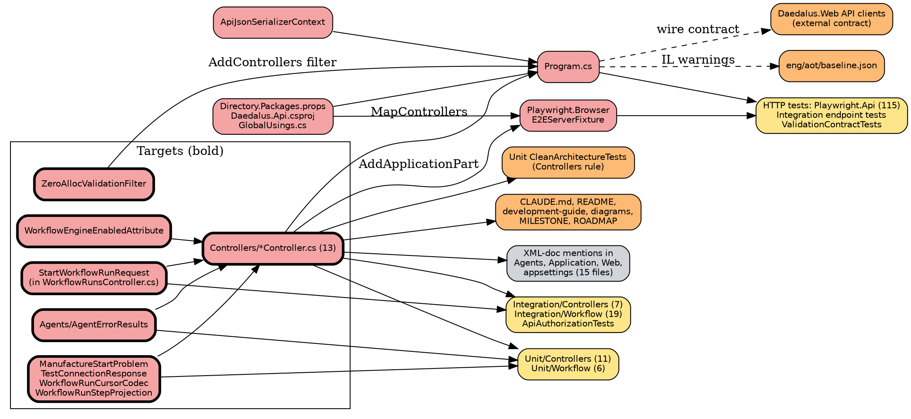

# Impact Analysis: Phase 3.4, controllers to minimal APIs

> Input to `docs/superpowers/plans/2026-10-31-phase-3.4-minimal-apis-plan.md`. Design:
> `docs/superpowers/specs/2026-10-31-phase-3.4-minimal-apis-design.md`. Mapped on branch `phase/3.4-minimal-apis` at
> `b9025e78`. Targets were confirmed by the owner on 2026-10-31, along with three decisions this analysis raised
> (below, "Owner decisions taken during the analysis").

## Summary

| Metric | Value |
|---|---|
| Date | 2026-10-31 |
| Refactor Type | Architectural: MVC controllers replaced by minimal API endpoint classes, same wire contract |
| Targets | 22 (13 controllers, 5 controller-folder helpers, 2 filters, `AgentErrorResults`, `StartWorkflowRunRequest`), plus the composition: `Program.cs`, the JSON context, the versioning package, the Browser test host |
| Endpoints moved | 61 across the 13 controllers |
| Directly Affected Files | 72 (25 source/build, 47 test) |
| Transitively Affected Files | 27 (comment or doc references, the architecture rule, the AOT baseline) |
| Total Affected Files | 99, plus about 20 new files |
| Breaking Changes | 70 files fail to compile or run once their controller is deleted |
| Risks Identified | 14 |
| Risk Level | **High**: more than 50 affected files, and three high-severity risks (implicit MVC behaviour, the external Web client contract, the second composition root) |

### Corrections to the design

The design was written before the reference map existed. These points in it are wrong or incomplete; the plan follows
this analysis where they differ, and each becomes a ruling in `docs/plans/2026-10-31-phase-3.4-rulings.md`.

1. **`tests/Daedalus.Tests.Integration/Controllers/*` do not test over HTTP.** The design says they "test over HTTP and
   must pass unchanged". Seven of them construct the controller directly and assert on `OkObjectResult`,
   `CreatedAtActionResult` and friends: `AgentMemories`, `AgentSessions`, `CodeAnalysis`, `Projects`, `Repositories`,
   `TaskExecutions`, `Tasks`. So do five cases in `Workflow/ResumeBoundaryTests.cs`. Only `SchedulesControllerTests`
   is not one of them. Owner decision: retarget them at the handlers, as the unit tests are.
2. **Three targets are missing from the design's list.** `src/Daedalus.Api/Agents/AgentErrorResults.cs` is
   MVC-bound (`ToActionResult(this AgentError, ControllerBase)` calls `controller.Problem(...)`), used 21 times by
   `AgentSessions` and `AgentMemories` and pinned by `Unit/Controllers/AgentErrorResultsTests.cs`.
   `StartWorkflowRunRequest` is declared at the bottom of `WorkflowRunsController.cs` and used by 16 test files.
   `tests/Daedalus.Tests.Playwright.Browser/Fixtures/E2EServerFixture.cs` is a second composition root: it calls
   `AddApiVersioning`, `AddControllers().AddApplicationPart(typeof(Program).Assembly)` and `MapControllers()` itself,
   and never runs `Program.cs`.
3. **`ApiAuthorizationTests` reflects over controller attributes.** It lists 8 controller types and reads
   `[Authorize]` off them; one of its assertions is `true.Should().BeTrue()` and cannot fail. Owner decision: rewrite
   it against `EndpointDataSource` on the booted host.
4. **"`Microsoft.AspNetCore.Mvc` usings go" is too strict.** `ProblemDetails`, `ValidationProblemDetails` and the
   binding attributes `[FromQuery]`, `[FromBody]`, `[FromRoute]`, `[FromServices]` live in the
   `Microsoft.AspNetCore.Mvc` namespace but in the shared-framework `Http.Abstractions` and `Mvc.Core` assemblies, and
   minimal APIs and the request delegate generator use them. What goes is MVC's *services and types*: `ControllerBase`,
   `IActionResult`, `ObjectResult`, `ProblemDetailsFactory`, filters, `AddControllers`, `MapControllers`,
   `Asp.Versioning.Mvc`. The end-of-phase check greps for those, not for the namespace.
5. **The request delegate generator has to be switched on.** It is on by default only when `PublishAot=true`. CI's
   `aot-analysis` passes `-p:PublishAot=true`, so the native publish would run generated delegates while every test
   ran the reflection `RequestDelegateFactory`. Owner decision: `EnableRequestDelegateGenerator=true` in
   `Daedalus.Api.csproj`, from the first ported controller.
6. **Problem `Content-Type` is not uniform.** 12 controllers carry `[Produces("application/json")]` and serve problem
   bodies as `application/json` (#366); `TasksController` does not, and serves `application/problem+json`.
   `ValidationContractTests` and `Playwright.Api/TasksPageTests` pin both sides. The snapshot and body-shape tests
   record content type per endpoint, not per stack.

### Owner decisions taken during the analysis, 2026-10-31

- Target list confirmed, including `AgentErrorResults`, `StartWorkflowRunRequest` and the Browser fixture. The
  Browser host switches to the same public `Map…Endpoints` extension `Program.cs` uses.
- Integration tests that construct controllers are retargeted at the handlers, case for case, red/green per assertion.
- `ApiAuthorizationTests` becomes an `EndpointDataSource` check: every `RouteEndpoint` carries an authorization policy
  or is on an explicit anonymous list.
- `EnableRequestDelegateGenerator=true` in the API project.

## Dependency Graph

## Affected Files

Complexity: **T** trivial (mechanical), **M** moderate (logic carried over, assertions rewritten), **C** complex
(behaviour must be rebuilt and pinned).

### Breaking: source and build (25)

| # | File | Change Required | Caused By | Cx |
|---|---|---|---|---|
| 1 | `src/Daedalus.Api/Controllers/AgentsController.cs` (21 lines, 1 endpoint) | Delete; `Endpoints/AgentEndpoints.cs` | port | T |
| 2 | `…/SchedulesController.cs` (55, 3) | Delete; `ScheduleEndpoints` | port | M |
| 3 | `…/TaskExecutionsController.cs` (60, 2; 2 catch-alls) | Delete; `TaskExecutionEndpoints` | port | M |
| 4 | `…/CostAnalyticsController.cs` (126, 5; 5 catch-alls) | Delete; `CostAnalyticsEndpoints` | port | M |
| 5 | `…/PrdController.cs` (145, 2; 2 catch-alls; llm limit) | Delete; `PrdEndpoints` | port | M |
| 6 | `…/ProjectsController.cs` (178, 6; 3 catch-alls; `CreatedAtAction`) | Delete; `ProjectEndpoints`, `Location` byte-equal | port | M |
| 7 | `…/BrainstormController.cs` (190, 7; 4 rate-limited) | Delete; `BrainstormEndpoints` | port | M |
| 8 | `…/AgentSessionsController.cs` (217, 6; SSE stream; `CreatedAtAction`) | Delete; `AgentSessionEndpoints`, SSE writer kept, compression bypassed | port, `aer` | C |
| 9 | `…/TasksController.cs` (237, 6; 5 `Problem`; no `[Produces]`) | Delete; `TaskEndpoints`; manufacture problem mapping | port, `ManufactureStartProblem` | C |
| 10 | `…/AgentMemoriesController.cs` (243, 3) | Delete; `AgentMemoryEndpoints` | port, `aer` | M |
| 11 | `…/RepositoriesController.cs` (312, 6; `CreatedAtAction`, `TestConnectionResponse`) | Delete; `RepositoryEndpoints` | port | M |
| 12 | `…/CodeAnalysisController.cs` (436, 8; dead `ModelState` checks) | Delete; `CodeAnalysisEndpoints`, `ModelState` checks dropped | port | C |
| 13 | `…/WorkflowRunsController.cs` (630, 6; 10 `Problem`; resource filter; cursor paging) | Delete; `WorkflowRunEndpoints`; gateway resolved lazily after the 503 filter | port, `wee`, codec, projection | C |
| 14 | `…/ManufactureStartProblem.cs` | Rewrite over `HttpContext` and typed results, move to `Endpoints/` | `ControllerBase` gone | M |
| 15 | `…/TestConnectionResponse.cs` | Move to `Endpoints/` (namespace change only; the Web reads the body untyped) | folder deleted | T |
| 16 | `…/WorkflowRunCursorCodec.cs` | Move with `WorkflowRunEndpoints` | folder deleted | T |
| 17 | `…/WorkflowRunStepProjection.cs` | Move with `WorkflowRunEndpoints` | folder deleted | T |
| 18 | `…/WorkflowEngineEnabledAttribute.cs` | Becomes an `IEndpointFilter` on the `workflow-runs` group, problem body without `ProblemDetailsFactory` | resource filter | C |
| 19 | `src/Daedalus.Api/Middleware/ZeroAllocValidationFilter.cs` | Becomes an `IEndpointFilter` over `EndpointFilterInvocationContext.Arguments`; same adapters, same `ValidationProblemDetails`; lives beside the MVC filter until the last controller moves | MVC filter | M |
| 20 | `src/Daedalus.Api/Agents/AgentErrorResults.cs` | `ToActionResult(ControllerBase)` replaced by a typed-result builder with the same `title`, `detail`, `status`, `code` extension, `traceId` and `type`; `ToStatusCode` unchanged | `ControllerBase` gone | M |
| 21 | `src/Daedalus.Api/ApiJsonSerializerContext.cs` | Web defaults, nulls written, every request/response type registered; first in `ConfigureHttpJsonOptions`, no reflection fallback | JSON design | C |
| 22 | `src/Daedalus.Api/Program.cs` | `MapDaedalusEndpoints()` grows per task; `AddControllers`/`MapControllers`, the `IsEnhancedModelMetadataSupported` switch and the MVC comments go last; JSON options; versioning | composition | M |
| 23 | `src/Daedalus.Api/GlobalUsings.cs` | `Asp.Versioning` stays (the Http package uses the same namespace) | versioning | T |
| 24 | `src/Daedalus.Api/Daedalus.Api.csproj` | `Asp.Versioning.Mvc` → `Asp.Versioning.Http`; `EnableRequestDelegateGenerator`; the `PublishAot` comment loses "MVC controllers" | package | T |
| 25 | `Directory.Packages.props` | `Asp.Versioning.Mvc` 8.1.0 → `Asp.Versioning.Http` 10.2.1; Renovate #402 closed | package | T |

### Breaking: tests (45)

| # | File | Change Required | Caused By | Cx |
|---|---|---|---|---|
| 26–36 | `tests/Daedalus.Tests.Unit/Controllers/`: `BrainstormControllerTests`, `CostAnalyticsControllerTests`, `ProjectsControllerConflictTests`, `TasksControllerConflictTests`, `TasksControllerManufactureTests` (also reflects on `Manufacture`'s attributes, line 242), `WorkflowRunsController{List,Resume,Retry,Scan,Start}Tests`, `AgentErrorResultsTests` | Call the handler; assert on the typed `Results<…>` value; drop `AddMvcCore().AddApiExplorer()` setup; folder renamed `Endpoints/` | handler classes | M |
| 37–42 | `tests/Daedalus.Tests.Unit/Workflow/`: `WorkflowRunCursorCodecTests`, `WorkflowRunStepProjectionTests`, `WorkflowRunViewDeferredTests`, `WorkflowRunViewFailureReasonTests`, `WorkflowRunViewJsonShapeTests` (`ToPinView`), `WorkflowRunViewPrUrlTests` | Namespace, and handler calls in place of `new WorkflowRunsController(...)` | moves | T/M |
| 43–49 | `tests/Daedalus.Tests.Integration/Controllers/`: `AgentMemories…`, `AgentSessions…` (asserts `ActionName == nameof(GetSession)`), `CodeAnalysis…`, `Projects…`, `Repositories…`, `TaskExecutions…`, `Tasks…IntegrationTests` | Retarget at handlers, case for case (owner decision); `ControllerContext` user setup becomes a `ClaimsPrincipal`/`HttpContext` argument | handler classes | M |
| 50–68 | `tests/Daedalus.Tests.Integration/Workflow/`: 19 files with `using Daedalus.Api.Controllers` (`StartWorkflowRunRequest`); `ResumeBoundaryTests` also constructs the controller in 5 cases; `WorkflowDisabledHostTests` names `[WorkflowEngineEnabled]` in its red note | Namespace of `StartWorkflowRunRequest`; `ResumeBoundaryTests` retargeted at handlers; red notes rewritten for the endpoint filter | `swr`, port | T (17), M (2) |
| 69 | `tests/Daedalus.Tests.Integration/Authentication/ApiAuthorizationTests.cs` | Rewritten over `EndpointDataSource` (owner decision); must be shown red by dropping one endpoint's policy | reflection over controller types | M |
| 70 | `tests/Daedalus.Tests.Playwright.Browser/Fixtures/E2EServerFixture.cs` | `AddControllers().AddApplicationPart` and `MapControllers` replaced by the public endpoint registration; versioning setup moves with it; it must also register the validation filter's needs, as `Program.cs` does | second composition root | M |

### Update Required (12)

| # | File | Change Required | Caused By | Cx |
|---|---|---|---|---|
| 71 | `tests/Daedalus.Tests.Unit/Architecture/CleanArchitectureTests.cs` | `Controllers_ShouldResideIn_ApiLayer` retargeted at endpoint classes (`HaveNameEndingWith("Endpoints")`); otherwise it passes vacuously once no `*Controller` exists | rule goes vacuous | T |
| 72 | `tests/Daedalus.Tests.Integration/Architecture/CleanArchitectureTests.cs` | Remarks name `ZeroAllocValidationFilter`; the rule itself (adapter per `[Validate]` DTO) stays true | comment | T |
| 73 | `tests/Daedalus.Tests.Integration/Api/ValidationContractTests.cs` | Assertions unchanged; red notes ("restore the controller-level Produces on TasksController") rewritten for the endpoint equivalent | red notes name MVC | T |
| 74 | `tests/Daedalus.Tests.Playwright.Api/Scenarios/TasksPageTests.cs` | Red note at line 86, as above | red note | T |
| 75 | `CLAUDE.md` | "REST controllers" → endpoints in the structure block | docs | T |
| 76 | `README.md` | 4 mentions | docs | T |
| 77 | `docs/development-guide.md` | 13 mentions; the controller pattern section becomes the endpoint pattern, typed results, the validation endpoint filter | docs | M |
| 78 | `docs/architecture-diagrams.md` | 61 mentions; diagrams show endpoint classes | docs | M |
| 79 | `docs/planning/MILESTONE.md` | "18 controllers" → 13; plan link; status | design call | T |
| 80 | `docs/planning/ROADMAP.md` | Same | design call | T |
| 81 | `eng/aot/baseline.json` | `Api` lowered to the count CI measures, in each task where it falls (the ratchet fails an unrecorded fall) | IL warnings | T |
| 82 | `docs/plans/2026-10-31-phase-3.4-rulings.md` (new) | Created by the plan; every task appends | process | T |

### Cosmetic (17)

XML-doc and comment mentions of a controller by name; updated to the endpoint class in the task that ports it, so
no `cref` or prose points at a deleted type.

| # | File | Mention |
|---|---|---|
| 83–89 | `src/Daedalus.Agents/`: `Workflow/DisabledManufactureRunStarter.cs`, `Workflow/WorkflowRunCanceller.cs`, `Workflow/WorkflowRunGateway.cs` (names `Daedalus.Api.Controllers.WorkflowRunsController.Resume`), `Workflow/IManufactureRunStarter.cs`, `DaedalusAgentsServiceCollectionExtensions.cs`, `Tools/DaedalusManufactureTools.cs`, `Tools/DaedalusScheduleTools.cs` | `WorkflowRunsController`, `SchedulesController` |
| 90 | `src/Daedalus.Api/Services/TaskManufactureService.cs` | `TasksController.Manufacture` |
| 91–93 | `src/Daedalus.Application/`: `Services/TaskRunGuard.cs`, `DTOs/WorkflowRuns/StartWorkflowRunResponse.cs`, `DTOs/WorkflowRuns/WorkflowRunViews.cs` | controller names |
| 94 | `src/Daedalus.Web/Services/RepositoriesApiClient.cs` | `TestConnectionResponse` |
| 95 | `src/Daedalus.Api/appsettings.json`, line 260 | `WorkflowRunsController` in a comment |
| 96 | `src/Daedalus.Cli/appsettings.json`, line 102 | same |
| 97–99 | tests: `Unit.Application/Agents/DaedalusAgentsRegistrationTests.cs` (assertion message), `Integration/Controllers/SchedulesControllerTests.cs`, `Integration/Authentication/RealKeycloakIdentityTests.cs`, `Unit/Workflow/WorkflowRunGatewayTests.cs`, `Playwright.Browser/Scenarios/RunsConsoleBrowserTests.cs` | controller names in remarks |

**Deliberately not touched:** `tests/Daedalus.Tests.Unit/Configuration/OptionsBindingGolden.appsettings.json` is a
frozen copy of the API's settings for binding tests, and a comment change binds nothing; the string
`"AgentSessionsController"` in `Playwright.Browser/Fixtures/StubAgentRuntime.cs` is tool-argument data, not a
reference; historical `docs/plans/*` and older specs are records of their phase.

### New files (about 20)

- `src/Daedalus.Api/Endpoints/`: 13 endpoint classes, one public `EndpointRouteBuilderExtensions` (`MapDaedalusEndpoints`)
  that both `Program.cs` and the Browser fixture call, the shared client-error ProblemDetails helper, the named error
  record (`{ "error": … }`), the two endpoint filters.
- `tests/Daedalus.Tests.Integration/Api/EndpointContractSnapshotTests.cs` and its checked-in snapshot file.
- `tests/Daedalus.Tests.Integration/Api/MvcBehaviourContractTests.cs` (the step 1b body-shape tests).
- `docs/plans/2026-10-31-phase-3.4-rulings.md`.

## Risk Register

| # | Risk | Affected Files | Severity | Mitigation |
|---|---|---|---|---|
| 1 | **Implicit `[ApiController]` behaviour missed:** client-error ProblemDetails on bodiless `NotFound()`/`Unauthorized()`/`Conflict()`, binding-failure 400 as `ValidationProblemDetails`, implicit `[Required]` on non-nullable body properties, `traceId` | all endpoint classes | High | Step 1b tests on the MVC build first; the design's behaviour table is the checklist; one implicit-required case per body DTO |
| 2 | **External consumer:** `Daedalus.Web` calls 10 route prefixes and deserializes the bodies; nothing compiles it against the API | `src/Daedalus.Web/Services/*ApiClient.cs` | High | Snapshot plus body-shape tests; Playwright.Browser (219) runs the Web against the real endpoints |
| 3 | **Second composition root:** the Browser fixture builds its own host and maps controllers itself; it breaks silently at runtime (404s), not at compile time, if it is not switched | `Playwright.Browser/Fixtures/E2EServerFixture.cs` | High | Switch it in the first port task to the shared `MapDaedalusEndpoints`; run Playwright.Browser at each checkpoint where a ported controller has a page |
| 4 | **`Location` casing:** `[Route("api/[controller]")]` keeps the class name's case, so `CreatedAtAction` emits `/api/Tasks/{id}`, `/api/Projects/…`, `/api/Repositories/…`, `/api/CodeAnalysis/…`; only `AgentSessions` has a `Location` assertion today | Tasks, Projects, Repositories, CodeAnalysis, AgentSessions | Medium | Step 1b asserts the exact `Location` per 201 on MVC first; the endpoint writes the same string |
| 5 | **Problem `Content-Type` per controller:** `application/json` on 12 controllers (#366), `application/problem+json` on Tasks | all | Medium | Snapshot and step 1b record it per endpoint; a shared helper takes the content type from the group, not a global |
| 6 | **RDG vs reflection delegate factory** behave differently on edge binding (optional `[FromQuery]` defaults, `[AsParameters]`, `IFormFile`) | all endpoints | Medium | `EnableRequestDelegateGenerator=true` from the first task (owner decision); RDG diagnostics treated as errors in review |
| 7 | **JSON source-gen gaps:** a request or response type missing from the context fails at runtime only; no reflection fallback by design | `ApiJsonSerializerContext` | Medium | Every endpoint hit by an HTTP test; snapshot lists response types, and a test asserts each one resolves from the context |
| 8 | **Nulls dropped:** today's context sets `WhenWritingNull`; plugged in unchanged it drops nulls MVC writes | `ApiJsonSerializerContext`, every DTO with a nullable property | Medium | Context reworked to web defaults before it is wired; step 1b null test |
| 9 | **`WorkflowRunGateway` resolved before the 503 filter** on a disabled host gives a bare 500 | `WorkflowRunEndpoints` | Medium | Resolve from `HttpContext.RequestServices` after the filter; `WorkflowDisabledHostTests` pins it |
| 10 | **AOT ratchet fails in both directions:** a fall CI measures but the change did not record fails the job, so a mid-phase task that removes warnings goes red | `eng/aot/baseline.json` | Medium | Read `aot-analysis` after each push; lower the baseline in the same task; no local AOT publish |
| 11 | **High fan-in:** `StartWorkflowRunRequest` (16 test files), `AgentErrorResults` (21 call sites, 2 controllers), `WorkflowRunsController` (11 test files) | listed | Medium | Move `StartWorkflowRunRequest` to `Endpoints/` in the `WorkflowRuns` task with its usings in one atomic change |
| 12 | **Double registration mid-phase:** a route served by both stacks gives ambiguous-match 500s | `Program.cs` | Medium | Controller deleted in the task that maps its endpoints (design) |
| 13 | **Ported tests pass for the wrong reason** | 32 retargeted test files | Medium | Red/green per assertion (CLAUDE.md); the reviewer checks one named mutation per assertion |
| 14 | **Versioning:** `Asp.Versioning.Http` must keep all three readers, `AssumeDefaultVersionWhenUnspecified`, `api-supported-versions`, and today's answer to an unsupported version | `Program.cs`, every group | Medium | Step 1b pins header and unsupported-version answers; the package's AOT status read from CI, upstream issue if not clean |

Dynamic references checked: no `nameof`/string use of controller names drives routing (`[Route]` uses the
`[controller]` token, covered by the snapshot). `TasksControllerManufactureTests` line 242 reflects on the action's
attributes and is retargeted. No serialized state names a controller. No circular dependencies: the controllers are
leaves that depend on Application, Agents and Api services; nothing in `src/` depends on them
(`AgentsProject_ShouldNotDependOn_ApiLayer` holds).

## Execution Order

Every group ends in a compiling, green state; the two stacks coexist from group 3 to group 15. Each controller group is
atomic: endpoint class, deletion of the controller, retargeted tests, comment mentions and Program registration in one
commit, so no route is ever served twice and no test references a deleted type.

### Group 1: Contract snapshot (before any code moves)
- New `EndpointContractSnapshotTests` and the snapshot file, generated from the MVC build: verb, route, policies,
  anonymous, rate limit, version, response metadata, content type.
- Shown red by removing one policy.
- **Checkpoint:** integration green, commit, push.

### Group 2: Body-shape tests on MVC
- New `MvcBehaviourContractTests`: nulls written; bodiless 401/404/409 ProblemDetails; malformed JSON 400; one
  implicit-required 400 per body DTO; the 500 catch body; problem `Content-Type` per controller; `Location` per 201
  (risk 4); `api-supported-versions`; unsupported version; 401-before-400 and 429-before-400.
- **Checkpoint:** integration green on MVC, commit, push.

### Group 3: Shared infrastructure, no endpoint yet
- `Endpoints/` with `MapDaedalusEndpoints` (empty), the client-error helper, the named error record, the
  `ZeroAllocValidationFilter` endpoint-filter form beside the MVC one, the `WorkflowEngineEnabled` endpoint filter,
  the typed-result `AgentErrorResults` builder beside the MVC one.
- `Asp.Versioning.Http` added beside `Asp.Versioning.Mvc`, one `ApiVersionSet`.
- `ApiJsonSerializerContext` reworked to web defaults and wired into `ConfigureHttpJsonOptions` (affects only minimal
  endpoints; MVC keeps its own options).
- `EnableRequestDelegateGenerator=true`.
- Browser fixture calls `MapDaedalusEndpoints` beside `MapControllers` (risk 3).
- **Checkpoint:** build, unit, integration, snapshot unchanged, commit, push, read `aot-analysis`.

### Groups 4–6: Pattern-setting ports, smallest first (each atomic)
- 4: `Agents` (1 endpoint). 5: `Schedules` (3). 6: `TaskExecutions` (2, catch-alls; retargets
  `Integration/Controllers/TaskExecutionsControllerIntegrationTests`, drops it from `ApiAuthorizationTests`'
  type list).
- **Checkpoint per group:** snapshot, body-shape, unit, integration, Playwright.Api green; commit; push.

### Group 7: `ApiAuthorizationTests` over `EndpointDataSource`
- Rewritten once three controllers have moved, so it is proven on both stacks; shown red.
- **Checkpoint:** integration green, commit.

### Groups 8–15: Middle controllers (each atomic)
- 8 `CostAnalytics`, 9 `Prd`, 10 `Projects` (`Location`), 11 `Brainstorm`, 12 `Repositories` (moves
  `TestConnectionResponse`), 13 `AgentMemories` and 14 `AgentSessions` (both move to the typed `AgentErrorResults`;
  the MVC overload and `AgentErrorResultsTests`' MVC cases go in 14; SSE in 14), then 15 `Tasks` (moves
  `ManufactureStartProblem`, `problem+json`).
- **Checkpoint per group:** as groups 4–6, plus Playwright.Browser for groups with a Web page (Projects, Brainstorm,
  Repositories, AgentSessions, Tasks).

### Group 16: `CodeAnalysis`
- Dead `ModelState` checks dropped (ruling).
- **Checkpoint:** as above.

### Group 17: `WorkflowRuns` (atomic; highest fan-in)
- Moves `WorkflowRunCursorCodec`, `WorkflowRunStepProjection`, `StartWorkflowRunRequest`; the 503 filter on the group;
  gateway resolved lazily; 5 unit `WorkflowRunsController*Tests`, 6 `Unit/Workflow` tests, 19 `Integration/Workflow`
  files, `ResumeBoundaryTests`' 5 direct cases, `WorkflowDisabledHostTests`' red note.
- **Checkpoint:** full suite including Playwright.Browser (runs console), commit, push.

### Group 18: MVC removed
- `AddControllers`, `MapControllers`, the MVC `ZeroAllocValidationFilter` form, `WorkflowEngineEnabledAttribute`,
  `Asp.Versioning.Mvc`, the `IsEnhancedModelMetadataSupported` switch, the empty `Controllers/` folder; the Browser
  fixture's `AddControllers`; the csproj `PublishAot` comment; `CleanArchitectureTests` controller rule retargeted.
- Grep gate: no `ControllerBase`, `IActionResult`, `ObjectResult`, `ProblemDetailsFactory`, `AddControllers`,
  `MapControllers`, `Asp.Versioning.Mvc` under `src/` and `tests/`.
- **Checkpoint:** full suite, push; `aot-analysis` shows the MVC warning family gone; baseline lowered; Renovate #402
  closed.

### Group 19: Documentation
- `CLAUDE.md`, `README.md`, `docs/development-guide.md`, `docs/architecture-diagrams.md`, `MILESTONE.md` and
  `ROADMAP.md` (13, not 18).
- **Checkpoint:** `dotnet format`, commit, push.
